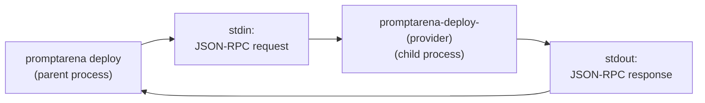
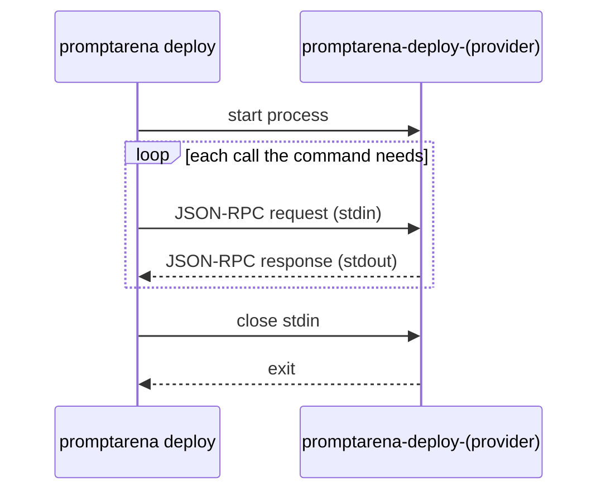

## Overview

Deploy keeps provider-specific logic in adapter binaries. The CLI starts an adapter as a child process and talks to it with JSON-RPC 2.0 over stdio. The CLI owns the workflow (config, pack, state, locking), and the adapter owns the cloud provider integration.

## Why Plugins?

Cloud providers have different APIs, resource models, authentication mechanisms and deployment patterns. Building all of that into the CLI would cost:

- Dependency weight: every provider SDK linked into one binary.
- Release coupling: a provider change would need a CLI release.
- Test scope: integration tests for every cloud provider in one repository.

Each adapter is instead an independent binary with its own dependencies, release cycle and test suite.

## Communication Model

The CLI writes one JSON-RPC request per line to the adapter's stdin and reads one response per line from its stdout:



- stdin carries requests from the CLI.
- stdout carries responses from the adapter.
- stderr carries the adapter's own logs. The CLI passes it through to your terminal (the TUI routes it into its log), and keeps the last few KiB: when the adapter exits mid-call, the error ends with what it wrote there, typically a panic trace.

The model needs no network configuration: no ports, no sockets and no TLS between the two processes.

## Adapter Discovery

When the CLI needs an adapter, it uses the first executable it finds:

1. Project-local: `.promptarena/adapters/promptarena-deploy-{provider}`
2. User-level: `~/.promptarena/adapters/promptarena-deploy-{provider}`
3. System PATH: standard `$PATH` lookup

This order lets you pin a project to a specific adapter version (project-local), install adapters once for all projects (user-level), or use adapters installed system-wide (PATH).

## Binary Naming Convention

Every adapter binary is named:

```text
promptarena-deploy-{provider}
```

The built-in registry holds four:

- `promptarena-deploy-omnia`: Omnia Kubernetes platform
- `promptarena-deploy-agentcore`: AWS Bedrock AgentCore
- `promptarena-deploy-vertex`: Google Agent Runtime
- `promptarena-deploy-foundry`: Azure AI Foundry hosted agents

Release assets carry a platform suffix (`_darwin_arm64`, `_linux_amd64`). `promptarena deploy adapter install` saves the binary under the name without the suffix.

## The Provider Interface

Every adapter implements the `Provider` interface from the `deploy` package:

```go
type Provider interface {
    GetProviderInfo(ctx context.Context) (*ProviderInfo, error)
    ValidateConfig(ctx context.Context, req *ValidateRequest) (*ValidateResponse, error)
    Plan(ctx context.Context, req *PlanRequest) (*PlanResponse, error)
    Apply(ctx context.Context, req *PlanRequest, callback ApplyCallback) (adapterState string, err error)
    Destroy(ctx context.Context, req *DestroyRequest, callback DestroyCallback) error
    Status(ctx context.Context, req *StatusRequest) (*StatusResponse, error)
    Import(ctx context.Context, req *ImportRequest) (*ImportResponse, error)
}
```

An adapter can also implement the optional `LoginProvider` interface (`GetLoginURL`, `CompleteLogin`) and advertise the `login` capability. `promptarena deploy login` uses it.

### Method Responsibilities

| Method | Purpose |
|--------|---------|
| `GetProviderInfo` | Return adapter name, version and capabilities |
| `ValidateConfig` | Check that provider config is valid. The CLI calls it before every plan, and `promptarena deploy config import` calls it after merging a profile. An invalid result stops the command before `Plan`, and its warnings print ahead of the plan's. |
| `Plan` | Analyze pack and config and report which resources will change |
| `Apply` | Create, update or delete resources on the cloud provider |
| `Destroy` | Remove all managed resources |
| `Status` | Query current resource health from the cloud provider |
| `Import` | Adopt an existing resource into the adapter's state |

### Data Flow

Each method receives structured input and returns structured output:

1. Plan receives the pack JSON, the merged deploy config, the serialized arena config, the environment name and the prior adapter state. It returns a list of resource changes, each with an action (`CREATE`, `UPDATE`, `DELETE`, `NO_CHANGE` or `DRIFT`), and a summary line.
2. Apply receives the same input as Plan. It performs the resource operations and returns an opaque state string, which the CLI persists for later operations.
3. Destroy receives the deploy config, environment and prior state. It removes the resources and returns no state.
4. Status receives the deploy config, environment and prior state. It returns the overall deployment status, per-resource health, and optionally an updated state string.
5. Import receives a resource type, name and provider identifier along with the deploy config, environment and prior state. It returns the resource's health and a new state string.

## Adapter State

The state string returned by `Apply` is **opaque** to the CLI. The CLI stores it in the state file and passes it back to the adapter on later operations. The adapter can encode whatever it needs:

- Resource IDs and ARNs
- Configuration hashes
- Deployment metadata
- Version information

Each adapter tracks state in the format that suits its provider, and the CLI needs no knowledge of provider resource models.

## Adapter Lifecycle

One CLI command drives one adapter process:



The adapter is not a long-running daemon, so there are no stale connections or background processes to manage.

## Buffer Management

Both sides read the stream line by line with a buffered scanner:

- Initial buffer: 64 KB
- Max line size: 10 MB

The 10 MB ceiling leaves room for plan and apply requests, which carry the whole pack and arena config in one line.

## Tradeoffs

### Benefits

- Independent releases: an adapter fix does not need a CLI release.
- Language flexibility: an adapter is any executable that speaks the protocol. The Go `adaptersdk` package provides `Serve()` for Go adapters.
- Simple protocol: line-delimited JSON-RPC over stdio is easy to debug and test.
- No network dependencies: local IPC, with no ports or TLS.

### Limitations

- Process overhead: each command spawns a new process.
- No streaming: the adapter returns all apply and destroy events in its final response, and the CLI prints them after the call completes.
- Binary distribution: you download a platform-specific binary for each adapter.

## See Also

- [Protocol](/arena/reference/deploy/protocol/): JSON-RPC method specifications
- [Adapter SDK](/arena/reference/deploy/adapter-sdk/): build your own adapter
- [State Management](/arena/explanation/deploy/state-management/): how state is persisted
