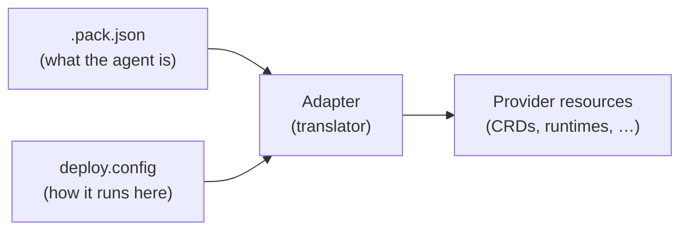

This page explains how a pack and a deploy config become a running agent, whichever adapter you use.

## The inputs

Every plan and apply request carries two primary inputs:

| Input | What it is | Who interprets it |
|-------|------------|-------------------|
| The **pack** (`.pack.json`) | The portable artifact compiled from your arena config: the same one you tested in Arena. | The adapter, and ultimately the runtime. |
| The **deploy config** (`spec.deploy.config` in the arena config) | Environment binding for one target. | Only the adapter. The CLI merges in the environment override and sends the result as JSON. |

The request also carries the serialized arena config. An adapter can read it for details the pack does not hold: the Omnia adapter reads the HTTP sources of the arena's tools from it.

The CLI does not interpret the contents of the pack or of `deploy.config`. It compiles the pack (or reads the one you pass with `--pack`), asks the adapter to validate the deploy config, sends both to the adapter as JSON, and the adapter translates them into provider-native resources:

## The pack is the portable contract

The pack describes what the agent is, independently of where it runs. The same pack can be tested locally, deployed to staging and promoted to production unchanged. It carries:

- Prompts and system templates: the agent's behavior.
- Tool contracts: the schemas the model sees (name, description, parameters). These define what the model may call.
- Validators: the guardrails enforced at runtime.
- Tool policies: allow and block lists that constrain tool use.
- Eval definitions: what "good" means for this agent.
- Agent topology: for multi-agent packs, the set of agents and how they relate.
- Identity and version: the pack ID and version.

If a fact about your agent holds wherever it runs, it belongs in the pack.

## The deploy config is the environment binding

`deploy.config` supplies what is specific to one environment, and therefore not in the pack:

- Which concrete model or provider serves the agent.
- How tools execute here (real endpoints, handlers, infrastructure).
- Credentials, authentication, scaling and other infrastructure settings.
- Per-environment overrides (dev, staging, production).

Each adapter defines this block, and the CLI does not interpret it. An AWS adapter's config looks nothing like a Kubernetes adapter's. Each adapter documents the fields it accepts and the resources it produces. This page covers only the shape of the relationship.

## The principle: declare abstractly, bind concretely

The line between pack and config follows one rule: the pack declares a capability abstractly, and the deployment binds it to concrete infrastructure. Two recurring forms of this answer most "where does X go?" questions.

**Contract and handler.** A pack carries a tool's contract: the schema the model calls against. It does not carry how that tool executes in production. The execution binding (an HTTP endpoint, an MCP server, a gRPC target) is specific to the environment, and the adapter supplies it at deploy time from the deploy config or the arena config. A tool the model can call and a tool the platform can run are two halves, bound from different inputs.

**Role and instance.** A pack is written against a role ("this agent needs an LLM", "this step needs an embedder"), not against a specific hosted model. The deployment binds those roles to concrete providers. The pack stays portable across providers because it never names one.

### Corollary: test-time and deploy-time providers are separate

The providers in `spec.providers` are test fixtures: they let Arena run scenarios against the pack locally. The adapter takes production bindings from `spec.deploy.config`, or derives them on the target platform. The serialized arena config, providers included, still reaches the adapter, and what an adapter reads from it is up to the adapter. A test provider and a deploy binding that share a name are unrelated.

## What's portable and what's bound

| Concern | Lives in | Why |
|---------|----------|-----|
| Prompts, system templates | Pack | The agent's behavior: portable. |
| Tool contracts (schemas) | Pack | What the model may call: portable. |
| Validators | Pack | Behavioral envelope: portable. |
| Tool policies (allow/block) | Pack | Behavioral envelope: portable. |
| Eval definitions | Pack | What "good" means: portable. |
| Agent topology | Pack | Structure: portable. |
| Model / provider binding | Deploy config (adapter) | Which infrastructure serves it: environment-specific. |
| Tool execution (handlers/endpoints) | Deploy config or arena config (adapter) | How tools run here: environment-specific. |
| Credentials, auth, scaling | Deploy config (adapter) | Infrastructure: environment-specific. |

## See Also

- [Deploy: Overview](/arena/explanation/deploy/overview/): what Deploy is and how the pieces connect
- [Adapter Architecture](/arena/explanation/deploy/adapter-architecture/): the JSON-RPC mechanics that carry these inputs to the adapter
- [Configure Deploy](/arena/how-to/deploy/configure/): adding the deploy section to the arena config
- Your adapter's own reference docs: the config fields it accepts and the resources it creates
