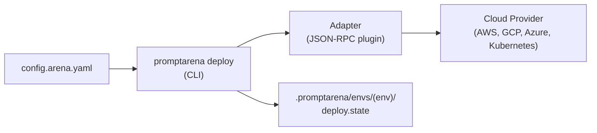

`promptarena deploy` ships the pack you tested with Arena to a cloud target through an adapter.

## What is Deploy?

Deploy is the PromptArena command family that ships packs to cloud providers through **adapters**: plugin binaries that translate one deploy workflow into provider-specific API calls.

### Why Adapters?

Cloud providers each have their own APIs, resource models and authentication flows. Deploy keeps that logic out of the CLI:

- The CLI offers the same commands for every target.
- Each adapter is a separate binary that speaks JSON-RPC over stdio.
- The CLI keeps local state: the pack checksum, timestamps and the adapter's own state.
- One config holds every environment, such as dev, staging and production.

### What Deploy Does

- Plans a deployment before applying it, in the style of `terraform plan`.
- Applies changes and prints the result for each resource.
- Tracks deployment state with a pack checksum and timestamps.
- Refreshes state from the live environment and imports existing resources.
- Destroys the resources it manages.
- Installs and discovers adapters.

## Quick Start

Install an adapter, add a `deploy` section under `spec` in your arena config, then plan and deploy:

```bash
promptarena deploy adapter install omnia
```

```yaml
# config.arena.yaml
spec:
  # ...prompt_configs, providers, defaults...
  deploy:
    provider: omnia
    config:
      api_endpoint: "https://omnia.example.com"
      workspace: "my-workspace"
      providers:
        - { name: default, ref: claude-prod, role: llm }
```

```bash
export OMNIA_API_TOKEN=omnia_sk_...   # or: promptarena deploy login
promptarena deploy plan
promptarena deploy
promptarena deploy status
```

Next: [First Deployment Tutorial](/arena/tutorials/deploy/first-deployment/)

## How It Works

The CLI compiles the pack from the arena config (or reads one passed with `--pack`), drives the adapter, and records the result in a local state file for the target environment:



## Documentation by Type

### Tutorials (Learn by Doing)

1. [First Deployment](/arena/tutorials/deploy/first-deployment/): install an adapter, configure, and deploy
2. [Multi-Environment](/arena/tutorials/deploy/multi-environment/): dev, staging and production environments

### How-To Guides (Accomplish Specific Tasks)

- [Install Adapters](/arena/how-to/deploy/install-adapters/): install, list and remove adapters
- [Configure Deploy](/arena/how-to/deploy/configure/): set up the deploy section in the arena config
- [Log In](/arena/how-to/deploy/login/): authenticate in the browser and write the config automatically
- [Plan and Apply](/arena/how-to/deploy/plan-and-apply/): plan, apply, status and destroy workflows
- [CI/CD Integration](/arena/how-to/deploy/ci-cd/): automate deployments with GitHub Actions

### Explanation (Understand the Concepts)

- [Anatomy of a Deployment](/arena/explanation/deploy/anatomy/): how a pack and a deploy config combine; what is portable and what is environment-bound
- [Adapter Architecture](/arena/explanation/deploy/adapter-architecture/): plugin pattern, JSON-RPC, stdio communication
- [State Management](/arena/explanation/deploy/state-management/): state file, checksums and deployment lifecycle

### Reference (Look Up Details)

- [CLI Commands](/arena/reference/deploy/cli-commands/): all deploy commands, flags and examples
- [Target Capabilities](/arena/reference/deploy/target-capabilities/): what each target supports, side by side
- [Adapter SDK](/arena/reference/deploy/adapter-sdk/): `Serve()`, `ParsePack`, `ProgressReporter` API
- [Protocol](/arena/reference/deploy/protocol/): JSON-RPC methods, types and error codes

## Supported Adapters

| Adapter | Provider | Description |
|---------|----------|-------------|
| `omnia` | Omnia Kubernetes platform | Deploy to an Omnia workspace as CRDs |
| `agentcore` | AWS Bedrock AgentCore | Deploy to AWS Bedrock AgentCore |
| `vertex` | Google Agent Runtime | Deploy to Agent Runtime, one engine per agent |
| `foundry` | Azure AI Foundry | Deploy Azure AI Foundry hosted agents |

Teardown, tool execution, A2A and observability differ between them. See [Target Capabilities](/arena/reference/deploy/target-capabilities/) before choosing. To target something else, [build your own adapter](/arena/reference/deploy/adapter-sdk/).

## Related Tools

- [PackC](/packc/): compile prompts into packs. `promptarena deploy` compiles the pack itself, and `packc` produces one to pass with `--pack`.
- [Arena](/arena/): test prompts before deploying.
- [SDK](https://promptkit.altairalabs.ai/sdk/): use deployed packs in Go applications.
