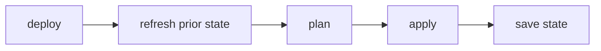

## Overview

Deploy records each deployment in a local file, `.promptarena/deploy.state`, so later commands can update, check, refresh and tear down what was deployed. This page explains what the file stores, when it changes, and why.

## Why State?

Without persistent state, the deploy system would need to:

- Query the cloud provider on every operation to discover existing resources
- Recreate resources that already exist
- Find out which resources to tear down without a record of what it created

State records what was deployed, when, and the information the adapter needs to manage those resources later.

## State File Location

The state file lives in the directory you run `promptarena deploy` from:

```text
project/
└── .promptarena/
    ├── deploy.state    # last deployment
    ├── deploy.plan     # plan saved by `deploy plan`, removed by apply
    └── deploy.lock     # present while a command holds the lock
```

- Directory permissions: `0750`
- File permissions: `0600` (read/write for owner only)
- Format: indented JSON

The CLI creates the `.promptarena/` directory the first time it saves state or takes the lock.

## State Structure

```json
{
  "version": 1,
  "provider": "agentcore",
  "environment": "production",
  "last_deployed": "2026-02-16T10:30:00Z",
  "pack_version": "",
  "pack_checksum": "sha256:abc123def456...",
  "adapter_version": "0.2.0",
  "last_refreshed": "2026-02-16T11:00:00Z",
  "state": "<opaque adapter state>"
}
```

| Field | Description |
|-------|-------------|
| `version` | State file format version (`1`) |
| `provider` | Name of the adapter that created this state |
| `environment` | Environment of the command that wrote the state |
| `last_deployed` | RFC 3339 timestamp (UTC) of the last successful apply |
| `pack_version` | Written empty by the CLI |
| `pack_checksum` | SHA-256 checksum of the deployed pack JSON (`sha256:{hex}`) |
| `adapter_version` | Version the adapter reported in `GetProviderInfo` |
| `last_refreshed` | RFC 3339 timestamp of the last refresh (omitted if never refreshed) |
| `state` | Opaque string from the adapter (resource IDs, metadata, etc.) |

## State Lifecycle

### Creation

The CLI writes state after a successful `deploy` or `deploy apply`:



The CLI builds the state from:

1. The provider name from the config and the environment from `--env` (or `default`)
2. The checksum of the pack it sent
3. The adapter version from `GetProviderInfo`
4. The opaque state string returned by `Apply`

`deploy import` also creates a state file when none exists, with an empty pack checksum.

### Reading

Commands load state when they need prior context:

- `deploy plan`: passes prior state to the adapter so it can compare current and desired resources
- `deploy` and `deploy apply`: the same as plan, then save the new state after apply
- `deploy status`: passes prior state so the adapter can look up resource IDs
- `deploy refresh`: passes prior state to `Status` and stores what comes back
- `deploy import`: passes prior state so the adapter can add the resource to it
- `deploy destroy`: passes prior state so the adapter knows what to tear down

`status`, `refresh` and `destroy` stop with `No deployment state found` when the file is absent.

### Update

Each successful `deploy` or `deploy apply` replaces the whole file. The new state has a new `last_deployed`, the checksum of the deployed pack, and the adapter state from the apply response.

### Deletion

A successful `deploy destroy` deletes the state file.

## Pack Checksums

The CLI computes a SHA-256 checksum of the pack JSON it deploys:

```text
sha256:e3b0c44298fc1c149afbf4c8996fb92427ae41e4649b934ca495991b7852b855
```

The checksum is stored in state and shown by `deploy status`. It identifies the exact bytes deployed.

The CLI also compares checksums when you run `deploy apply` after `deploy plan`: it reuses the saved plan only when the checksum and environment match. A compiled pack records its compile time, so every compile produces a new checksum. To compare deployments or reuse a saved plan, compile once with `packc` and pass the file with `--pack`.

The checksum is not sent to the adapter. Adapters decide what changed from the pack itself and their own state.

## Opaque Adapter State

The `state` field is a string that only the adapter interprets. The CLI:

- Stores it after `Apply`, and after `Status` or `Import` returns a new one
- Passes it back to the adapter on later operations
- Never reads or modifies its contents

Adapters typically encode:

- Cloud resource IDs (instance ARNs, endpoint URLs)
- Configuration hashes for change detection
- Deployment metadata (creation timestamps, tags)
- Internal version identifiers

Each adapter tracks the provider-specific information it needs, and the CLI needs no knowledge of resource models across cloud platforms.

## State and Environments

A project directory has one state file, whichever environment you target. The file holds the last deployment written, and `environment` records which environment that was.

The CLI does not check `environment` before using the state. After `deploy --env production`, a `deploy status --env staging` or `deploy destroy --env staging` sends production's adapter state to the adapter. To deploy several environments from one checkout, keep each environment's state separately (for example, a separate working directory or CI artifact per environment).

## State and CI/CD

A CI runner starts with a clean checkout, so the state file is gone unless you persist it. See [CI/CD Integration](/arena/how-to/deploy/ci-cd/) for strategies:

- Committing state to the repository
- Using artifact storage
- Relying on the adapter to discover existing resources

## State Refresh

Local state drifts from the cloud when someone changes resources in a console or with another tool. Refresh re-syncs local state with what is live.

### Pre-plan Refresh

When state exists, `deploy`, `deploy plan` and a re-planning `deploy apply` call the adapter's `Status` before planning. If it returns a new adapter state, the CLI saves it and records `last_refreshed`, so the plan starts from what is live. A failed refresh does not stop the plan; it uses the stored state.

### Manual Refresh

`deploy refresh` runs the same refresh without planning:

```bash
promptarena deploy refresh --env production
```

It calls the adapter's `Status` method, stores the adapter state it returns, records `last_refreshed`, and prints the status and health of each resource. Drift shows up as a `DRIFT` action (`!`) in the next plan, if the adapter reports it.

### Resource Import

`deploy import` brings a resource that already exists under deploy management. Use it for resources created outside the deploy workflow, for example by hand or with another tool:

```bash
promptarena deploy import agent_runtime my-agent container-abc123
```

Import calls the adapter's `Import` method with the resource type, name and identifier, then saves the adapter state it returns.

## State Locking

Deploy takes an exclusive lock on `.promptarena/deploy.lock` so that two commands in the same directory cannot write state at once:

- Unix and Linux: `flock(2)` with `LOCK_EX|LOCK_NB`
- Windows: `LockFileEx` with `LOCKFILE_EXCLUSIVE_LOCK|LOCKFILE_FAIL_IMMEDIATELY`

`deploy`, `deploy apply`, `deploy destroy`, `deploy refresh` and `deploy import` take the lock before reading state. `deploy plan` and `deploy status` do not. If another process holds the lock, the command fails at once with `deploy lock is held by another process` instead of waiting. The operating system releases the lock when the holding process exits, and the CLI deletes the lock file when it unlocks.

## Tradeoffs

### Benefits

- Incremental updates: the adapter sees what it deployed last time.
- Clean teardown: the adapter state records which resources to delete.
- Audit trail: timestamps, adapter version and pack checksum.
- Simple format: plain JSON, easy to inspect and debug.

### Limitations

- Local only: state is stored on disk, not in a remote backend.
- One deployment per directory: environments share the state file.
- Single machine: the lock prevents concurrent deploys in one directory, but does not coordinate across machines.

## See Also

- [Adapter Architecture](/arena/explanation/deploy/adapter-architecture/): how adapters use state
- [Plan and Apply](/arena/how-to/deploy/plan-and-apply/): deployment workflows
- [CLI Commands](/arena/reference/deploy/cli-commands/): status and destroy commands
