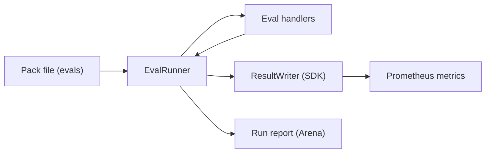
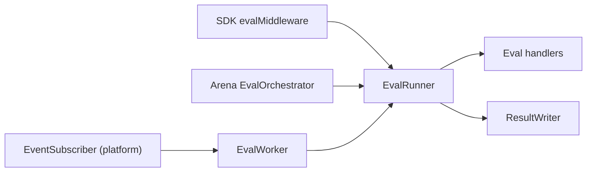
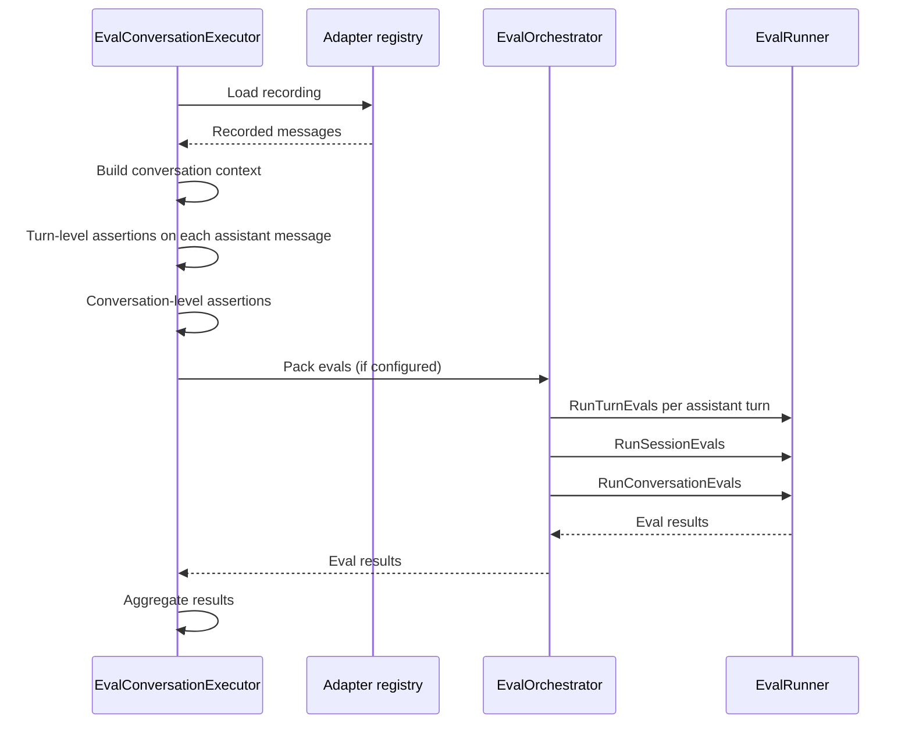

How PromptKit's evals score LLM output, and where they run in Arena, the SDK and an event-driven worker.

## What evals are

Evals are automated quality checks that run against LLM output. They answer questions such as "Did the assistant stay on topic?", "Was the JSON valid?" and "Did it call the right tools?". You define them in the pack file, and they run during conversations or against recorded sessions.

Evals use the same [check types](https://promptkit.altairalabs.ai/reference/checks/) as assertions and guardrails. They differ in when and where they run. An eval can fire in production on every turn, on a sampled subset, or at session close. An assertion runs only during Arena tests, and a guardrail runs inline before the response is delivered.

Eval handlers produce scores only (0.0 to 1.0). Pass/fail belongs to the `assertion` and `guardrail` wrapper types, which wrap an inner eval and compare its score to `min_score` and `max_score` in the wrapper's `params`. A plain eval records its score as a metric and emits an event.

The `EvalRunner` runs the handlers. Its caller decides where the results go: the SDK passes them to a `ResultWriter` (`MetricResultWriter`, which writes Prometheus metrics), and Arena reads them directly into the run report.



For the check types available as evals, see the [Checks Reference](https://promptkit.altairalabs.ai/reference/checks/).

## Pack evals and scenario assertions

PromptKit has two mechanisms that share the same check types:

| | Pack evals | Scenario assertions |
|---|---|---|
| Defined in | Pack file (`evals` array) | Arena scenario YAML |
| Scope | Any conversation using the pack | Specific test scenarios |
| Runs | Production and testing | Testing only |
| Trigger | Configurable (every turn, sampling, session close) | Every turn or conversation end |

Pack evals travel with the pack, so they run in production, in Arena tests and anywhere else the pack is used. They work as built-in quality monitors. Scenario assertions are Arena test expectations for specific conversation flows. Both can coexist: pack evals give baseline monitoring and assertions verify specific behaviours. See [Unified Check Model](https://promptkit.altairalabs.ai/concepts/validation/) for how evals, assertions and guardrails relate.

## Eval definitions

Each eval is an entry in the pack's `evals` array with an `id`, a check `type`, a `trigger` and optional `params`, `metric` and `groups`. The [Pack Evals reference](/arena/reference/pack-evals/) lists the fields, triggers, groups and metric types the runtime acts on.

```json
{
  "id": "quality_check",
  "type": "contains",
  "trigger": "every_turn",
  "params": { "patterns": ["thank you"] },
  "enabled": true,
  "metric": {
    "name": "response_quality",
    "type": "gauge",
    "labels": { "category": "tone" }
  }
}
```

To gate on a score, wrap the check in the `assertion` or `guardrail` type and set `min_score` and `max_score` in its `params`, with the inner check in `eval_type` and `eval_params`. With neither set, `min_score` defaults to 1.0.

## Triggers and sampling

The trigger decides how often an eval costs something. `every_turn` evals run after each assistant response, and `on_session_complete` and `on_conversation_complete` evals run once at the end. `sample_turns` and `sample_sessions` evaluate a percentage, 5 by default, which keeps a judge-backed check affordable in production.

Sampling is deterministic. The same session ID and turn index always give the same decision (FNV-1a hash), so runs are reproducible. For `sample_sessions` the decision depends on the session ID only.

`on_conversation_complete` evals run in Arena and in `sdk.Evaluate` with `Trigger` set. A live SDK conversation does not fire them.

```json
{
  "id": "toxicity_check",
  "type": "contains",
  "trigger": "sample_turns",
  "sample_percentage": 10,
  "params": { "patterns": ["harmful", "offensive"] }
}
```

## Eval groups

Groups let you run a subset of a pack's evals. An eval with no explicit `groups` is classified by its handler type: deterministic checks such as `contains` and `regex` get `["default", "fast-running"]`, and `llm_judge` gets `["default", "long-running", "external"]`.

Setting `groups` explicitly replaces the automatic classification. This eval matches a filter for `compliance` or `safety`, and does not match `default`, `long-running` or `external`:

```json
{
  "id": "compliance_check",
  "type": "llm_judge",
  "trigger": "every_turn",
  "groups": ["compliance", "safety"],
  "params": { "criteria": "Check regulatory compliance" }
}
```

In the SDK, `EvalGroups` selects which groups run. A nil or empty list runs every eval.

```go
// Only run fast evals in the hot path
results, _ := sdk.Evaluate(ctx, sdk.EvaluateOpts{
    PackPath:   "./app.pack.json",
    Messages:   messages,
    EvalGroups: []string{"fast-running"},
})
```

## Where evals run

Three paths execute evals, and all of them go through `EvalRunner`.

The SDK's `evalMiddleware` calls `EvalRunner` directly in the conversation's process. Turn evals run asynchronously in goroutines bounded by a semaphore, so they do not delay the response. Session evals run synchronously when you close the conversation. It builds the `EvalContext` from the conversation state and passes the results to the `ResultWriter`, which records metrics.

Arena's `EvalOrchestrator` wraps `EvalRunner` and calls its `Run*Evals` methods directly. It builds its own `EvalContext` and returns results to the run report. Arena scores every trigger when the conversation ends: it replays the turn triggers (`every_turn`, `sample_turns`) once per assistant turn, over the transcript up to that turn's reply, then runs the session triggers and `on_conversation_complete`. A turn ends at the assistant reply before the next user message, so the intermediate replies of a tool loop are not scored separately.

`EvalWorker` is the event-driven path. It subscribes to `eval.turn.*` and `eval.session.*` events through an `EventSubscriber` that your platform supplies, runs `EvalRunner`, and writes the results through a `ResultWriter`. This path suits deployments where evals run in a separate process from the conversation.



## Eval executor (Arena)

`EvalConversationExecutor` evaluates saved conversations from recordings, so you can score historical conversations without re-running them against a live LLM. No assistant turn is regenerated. Judge-backed evals such as `llm_judge` still call the configured judge provider.



## Metrics and Prometheus

The SDK records eval results as Prometheus metrics through the unified `metrics.Collector`, which also records pipeline metrics into a standard `prometheus.Registry`. Arena records no Prometheus metrics.

```go
import (
    "github.com/prometheus/client_golang/prometheus"
    "github.com/AltairaLabs/PromptKit/runtime/v2/metrics"
    "github.com/AltairaLabs/PromptKit/sdk/v2"
)

reg := prometheus.NewRegistry()
collector := metrics.NewCollector(metrics.CollectorOpts{
    Registerer:  reg,
    Namespace:   "myapp",
    ConstLabels: prometheus.Labels{"env": "prod"},
})

conv, _ := sdk.Open("./app.pack.json", "chat",
    sdk.WithMetrics(collector, nil),
)
```

With `WithMetrics()` set, every eval result is recorded. An eval with a `metric` definition uses it. An eval without one gets an auto-generated gauge named after the eval ID. Eval metrics are namespaced under `{namespace}_eval_`: a metric named `response_quality_score` in namespace `myapp` becomes `myapp_eval_response_quality_score`, and an eval with ID `check_tone` and no explicit metric becomes `myapp_eval_check_tone`. The eval ID is used as the metric name unchanged. A hyphenated ID such as `check-tone` still registers with the Prometheus client in this repo's `go.mod`, which validates names as UTF-8, but the name needs quoting in PromQL, so eval IDs written with underscores are easier to query. See the [Metrics Reference](https://promptkit.altairalabs.ai/runtime/reference/metrics/) for the full catalog.

A metric's type is `gauge`, `counter`, `histogram` or `boolean`, and the [Pack Evals reference](/arena/reference/pack-evals/#metric-definition) describes each.

Labels come from three places:

- Pack-author labels go in `metric.labels` on the eval definition, for example `{"eval_type": "llm_judge", "category": "quality"}`.
- Const labels come from `CollectorOpts.ConstLabels` and are process-level dimensions such as env or region.
- Instance labels come from `CollectorOpts.InstanceLabels` and bind per conversation, for dimensions such as tenant or prompt name.

Label names must match `^[a-zA-Z_][a-zA-Z0-9_]*$` and must not start with `__`. Pack validation does not check them. An invalid name surfaces later as a failed Prometheus registration, logged as a warning.

## Events

Eval results emit events through the EventBus:

| Event | Constant | When |
|-------|----------|------|
| `eval.completed` | `EventEvalCompleted` | The eval finished, whatever the score |
| `eval.failed` | `EventEvalFailed` | The handler returned an error |

The `eval.completed` payload (`EvalCompletedData`) carries the eval ID, type, kind, trigger, score, value and `passed`. `Passed` is a `*bool` copied from the result. The `assertion` and `guardrail` wrappers set it, and it is nil for plain evals.

:::caution
`eval.failed` means the eval errored, not that the score was low. A working eval that returns 0.0 emits `eval.completed`.
:::

## Pack eval resolution

When a pack and a prompt both define evals, they are merged. A prompt eval overrides a pack eval with the same ID, pack-only evals are kept, and prompt-only evals are appended. Packs define baseline evals and individual prompts customise or extend them.

## Trade-offs

Separating scoring from judgment lets one check serve as a metric in production and as a gate in a test. The cost is that a plain eval never fails by itself: to fail a run on a low score, wrap the check in `assertion`.

Asynchronous turn evals keep latency out of the response path, but their results arrive after the turn completes. Session evals run synchronously on close, so a slow judge delays `Close`. Use the `fast-running` group on the hot path and leave judge-backed checks to sampling or to `EvalWorker`.

Histograms use fixed default buckets, which suit latencies better than 0 to 1 scores. Prefer a gauge for scores unless you need a distribution.

## Example

The [`eval-test` example](/arena/examples/eval-test/) is a working Arena configuration that evaluates saved conversations with deterministic assertions and an LLM judge. The source is on [GitHub](https://github.com/AltairaLabs/promptarena/tree/main/examples/eval-test).

## Related pages

- [Pack Evals](/arena/reference/pack-evals/): eval fields, triggers, groups and metric types
- [Checks Reference](https://promptkit.altairalabs.ai/reference/checks/): all check types and parameters
- [Unified Check Model](https://promptkit.altairalabs.ai/concepts/validation/): how evals, assertions and guardrails relate
- [Run Evals](https://promptkit.altairalabs.ai/sdk/how-to/run-evals/): programmatic eval execution via the SDK
- [Assertions Reference](/arena/reference/assertions/): test-time checks
- [Observability](https://promptkit.altairalabs.ai/sdk/explanation/observability/): EventBus architecture
- [Session Recording](/arena/explanation/session-recording/): how recordings feed into evals
- [Metrics Reference](https://promptkit.altairalabs.ai/runtime/reference/metrics/): all emitted metrics
- [Monitor Events](https://promptkit.altairalabs.ai/sdk/how-to/monitor-events/): event hooks and Prometheus metrics in the SDK
