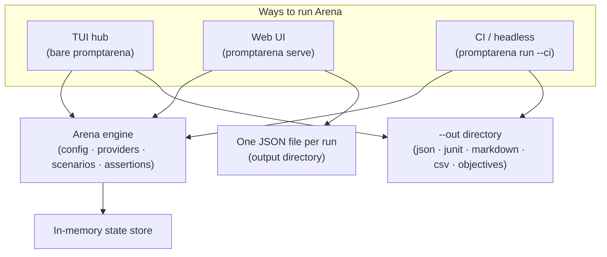

Arena has one engine and three ways to drive it. The config, providers, scenarios and
assertions are the same under all of them. What changes is how you start a run, how you watch
it, and what it leaves on disk:

- The TUI, a full-screen interactive terminal hub for local development and exploration.
- The Web UI, a local web server with a dashboard and live streaming, for visual monitoring and demos.
- CI / headless mode, plain-log execution with machine-readable reports, for automation and regression gates.

## At a glance

| Interface | How you launch it | Best for |
|-----------|-------------------|----------|
| TUI | `promptarena` (bare), or `promptarena view` / `promptarena chat` to deep-link | Local interactive development, exploring past results, ad-hoc chat |
| Web UI | `promptarena serve` (prints `http://localhost:8080`; add `--open` to open a browser) | Visual monitoring, sharing a run view, demos |
| CI / headless | `promptarena run --ci` | Automation, regression gates, pipelines |

## One engine, three surfaces

The diagram shows each surface calling the same engine, and what each one writes.

The three surfaces are peers on top of the same execution engine, so a scenario behaves the
same whichever one starts it. The files they leave behind differ:

- `promptarena run` (with `--ci`, `--simple` or its own TUI) writes every configured report
  format to the `--out` directory, `out` by default.
- `promptarena serve` writes one `<runID>.json` per run. It has no `--out` flag, so it uses the
  output directory `run` resolves from the config (`out` by default) and lists the results
  `run` wrote there.
- A run started from the hub's Run page writes the report formats `promptarena run` would
  write with no flags (`defaults.output.formats`, else `json`) to the output directory, resolved
  against the loaded config's directory.

## The TUI: interactive terminal hub

Running `promptarena` with no subcommand opens a full-screen [Bubble Tea](https://github.com/charmbracelet/bubbletea)
hub with five pages. View browses and inspects past run results. Run launches scenarios and
shows turns as they execute. Chat talks to an agent defined in your config, in text or
hands-free voice. Inspect shows the resolved configuration Arena is working from. Deploy ships
the pack to a target environment through a deploy adapter.

Two subcommands deep-link into the hub for a single task: `promptarena view` opens the results
browser, and `promptarena chat` opens an interactive chat session (add `--voice` for hands-free
voice mode). Everything is keyboard-driven and runs in your terminal.

The TUI suits local iteration: you edit prompts and scenarios, run them, read what came back,
and try again. It is the default because that loop is the most common way to work with Arena.
Use `promptarena run` when you need run flags such as `--formats`, `--out` or a scenario filter.

See [Use the TUI](/arena/how-to/interfaces/use-the-tui/).

## The Web UI: local web server with live streaming

`promptarena serve` starts a local web server on port 8080 and prints its URL. It listens on
the loopback addresses, and moves to the next free port if 8080 is taken. It serves a React
single-page app backed by a REST API, and streams run events to the browser over Server-Sent
Events (SSE). From the browser you get a dashboard, live monitoring of a run as its turns
complete, a way to start a run without the terminal, an interactive chat tab, and real-time
audio monitoring for voice agents.

The Web UI suits a run that more than one person watches, or that someone outside a terminal
watches: a demo, a screen-share, or a shared view of a long run in progress. For demos without
live provider credentials, pair it with `--mock-provider` so canned responses drive the
conversation while tools still execute for real.

The server binds to loopback only. It is a local companion to your workflow and is not meant
to be exposed publicly.

See [Use the Web UI](/arena/how-to/interfaces/use-the-web-ui/).

## CI / headless: plain logs and machine-readable reports

`promptarena run --ci` disables the interactive TUI and emits plain, line-oriented logs suited
to a build log. It exits non-zero when a run errors or an assertion fails, which is what makes
it a gate. `--simple` also disables the TUI, but prints styled output with a live status bar
and exits 0 on failures, so it does not fail a build.

Reports are selected with `--format` (alias `--formats`), which takes any combination of
`json`, `junit`, `markdown`, `csv` and `objectives`. See
[Output Formats](/arena/reference/output-formats/) for what each contains.

This is the surface for automation: regression gates that fail a build when assertions break,
scheduled evaluation jobs, and any pipeline that needs a machine-readable verdict. A packaged
GitHub Action wraps this mode so you can run Arena as a workflow step without installing the
binary yourself.

See [Run Arena in CI](/arena/how-to/interfaces/run-in-ci/).

## Choosing between them

The three surfaces coexist, and most projects use more than one:

- Use the TUI when you are the audience and you are iterating locally.
- Use the Web UI when other people are the audience, or you want a richer visual view.
- Use CI / headless mode when no one is watching and a machine needs the result.

Because they share an engine and a config, moving between them costs nothing. The scenarios you
refine in the TUI are the ones your CI pipeline gates on, and the ones you put on screen with
`serve`.

## See also

- [Use the TUI](/arena/how-to/interfaces/use-the-tui/)
- [Use the Web UI](/arena/how-to/interfaces/use-the-web-ui/)
- [Run Arena in CI](/arena/how-to/interfaces/run-in-ci/)
- [Reference: CLI Commands](/arena/reference/cli-commands/)
- [Reference: Output Formats](/arena/reference/output-formats/)
