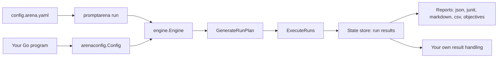

Arena runs as a command-line tool or as a Go library. Both drive the same engine, so the choice depends on who writes the tests and how often they change, not on what Arena can do.

## How the two paths relate

The CLI is a thin wrapper around the engine. `promptarena run` loads a YAML config, builds an `Engine` and calls `ExecuteRuns`. A Go program does the same calls itself.



From the CLI you write `promptarena run -c config.arena.yaml`. From Go, `engine.NewEngineFromConfigFile("config.arena.yaml")` loads the same file, and `engine.NewEngine` takes registries you assemble yourself. Either way `ExecuteRuns(ctx, plan, concurrency)` returns the run IDs, and you read each result from the engine's state store.

```go
eng, err := engine.NewEngineFromConfigFile("config.arena.yaml")
if err != nil {
	return err
}
defer eng.Close()

plan, err := eng.GenerateRunPlan(nil, nil, nil, nil)
if err != nil {
	return err
}
runIDs, err := eng.ExecuteRuns(ctx, plan, 4)
```

The [Use Arena as a Go Library](/arena/how-to/setup/use-as-go-library/) guide covers building a config in code, reading results and the full engine setup.

## What the CLI gives you

The CLI fits work where the tests are stable files that a team reviews together.

- Fast iteration: Edit the YAML and run again, with no compile step. `promptarena run --scenario greeting-test` or `--provider <id>` narrows a run, and `--verbose` adds logging.
- Team collaboration: Scenarios live in config files committed to git, so changes show up in review and everyone runs the same suite.
- CI: `promptarena run --ci --format junit` produces a report your CI system reads. See [Run in CI](/arena/how-to/interfaces/run-in-ci/).
- An interactive TUI: A plain `promptarena run` in a terminal shows progress, logs and results as they arrive.
- Debugging commands: `promptarena debug --config arena.yaml` and `promptarena config-inspect` show how a config resolves.

The built-in outputs are json, junit, markdown, csv and objectives. If you need results in another system, you either parse those files or shell out to the binary and parse its output.

## What the library gives you

The library fits work where the tests are produced or consumed by code.

- Dynamic test generation: Build `arenaconfig.Scenario` values from a database or another source and assign them to `cfg.LoadedScenarios`. YAML is awkward to generate at that scale.
- Application integration: Run Arena inside your service without launching a process.
- Custom result handling: Read each result from the state store and send metrics to your own systems.
- Conditional workflows: Retry, adjust the config between runs or branch on earlier results, all in ordinary Go.
- Testing tools: Build specialised runners on top of the engine.

The cost is a compile step on every change and a need to know Go and the engine API, so onboarding is slower than with the CLI.

## Performance and debugging

A CLI run starts one process per execution, and memory stays isolated to that run. A library call runs in your process and shares its memory, which suits high-frequency testing. Configuration loading and provider setup cost the same on both paths.

For quick troubleshooting the CLI is easier: `--verbose`, `debug` and `config-inspect` need no code. For deep debugging the library lets you use standard Go tooling and log the config and results directly.

## Combining both

The two paths work side by side.

- CLI for the stable suite, code for the rest: Run regression tests with `promptarena run -c regression-tests.yaml --ci` and keep dynamic or experimental tests in a Go program.
- Generate a config, run it with the CLI: Write a config file from your data, then run `promptarena run generated.arena.yaml`. You keep CLI reporting and avoid linking the library.
- CLI during development, a custom runner in CI: Iterate with `promptarena run --verbose`, then run a Go binary with extra logic in your pipeline.

You can also move gradually. Load your existing YAML with `NewEngineFromConfigFile`, add result handling in Go, and build the config in code only when you need to. The [Go library how-to](/arena/how-to/setup/use-as-go-library/) walks through each of these.

## Choosing

Start with the CLI if you are new to Arena, your tests are stable and predefined, or your team does not write Go. Move to the library when you need to integrate with an application, generate tests at runtime, process results in custom ways or run conditional workflows. Use both when some tests are standard and others are custom.

## Related pages

- [Tutorial: Programmatic Usage](/arena/tutorials/07-programmatic-usage/)
- [How-to: Use as Go Library](/arena/how-to/setup/use-as-go-library/)
- [Reference: CLI Commands](/arena/reference/cli-commands/)
- [Reference: API Reference](/arena/reference/api-reference/)
