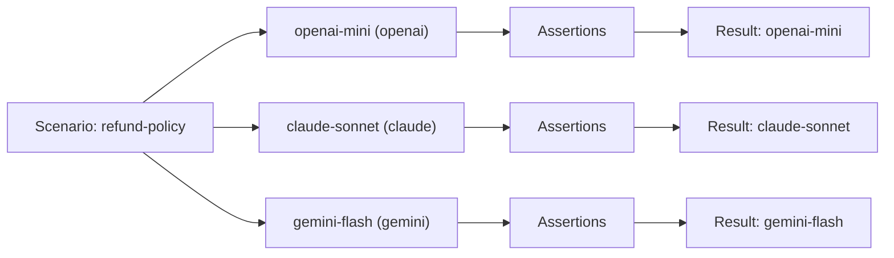

Providers differ in quality, tone, capabilities, speed, cost and reliability. Arena runs the same scenario against each provider you list and scores every reply with the same assertions, so you can see those differences in your own workload instead of in a vendor's benchmark. This page explains how that comparison works and what to expect from each provider type.

## How a cross-provider run works

A scenario names the providers that run it in `spec.providers`. Each id must match a provider defined in the Arena config. `promptarena validate` reports an id that matches none as an error. `promptarena run --provider <id>` narrows the set further. The same turns and assertions apply to every provider, and each provider gets its own result.

The diagram shows one scenario fanning out to the providers in an Arena config, then converging on the assertions.



Provider types include `openai`, `claude`, `gemini`, `ollama`, `vllm`, `imagen`, `replay` and `mock` (for tests). This page compares the first four. The provider ids are free strings that you choose in each provider file.

A scenario that compares three providers looks like this. Per-turn assertions go on the turn, and `message` sits beside `params`, not inside it. Validation rejects a param name an assertion does not accept (`max_msx` for `latency_budget`, for example) and any scenario or turn field outside the schema.

```yaml
apiVersion: promptkit.altairalabs.ai/v1alpha1
kind: Scenario
metadata:
  name: refund-policy
  labels:
    suite: cross-provider
spec:
  task_type: assistant
  description: "Same question, every provider"
  providers: [openai-mini, claude-sonnet, gemini-flash]
  turns:
    - role: user
      content: "What's your refund policy?"
      assertions:
        - type: content_includes
          params:
            patterns: ["refund", "days"]
          message: "Must mention refund policy details"
        - type: llm_judge
          params:
            criteria: "Response is helpful and informative"
            judge: quality
          message: "Must be helpful"
        - type: latency_budget
          params:
            max_ms: 5000
```

The `judge: quality` value names an entry in the Arena config's `spec.judges`, which maps a judge name to one of the configured providers. A `judge` name that `spec.judges` does not define fails when the config loads. An `llm_judge` can also pick its judge with `params.provider`. Use `metadata.labels` to tag scenarios, for example to group a fast-provider suite apart from a premium one.

## What differs between providers

### OpenAI

The `openai` type covers the GPT-5.x and GPT-6.x models, such as `gpt-5.4` and `gpt-5.4-mini`, and the `o3` reasoning model. It is a good default for general reasoning, tool calling and structured output. Replies tend to be concise and well structured, often with bullet points. That makes it a natural baseline, and also a reason not to write assertions that depend on its exact phrasing.

### Claude

The `claude` type covers the Claude families. The context window is 200K tokens for the Claude 4.5 family and 1M tokens for Claude 4.6 and later and for Claude 5, according to the runtime's table. Replies tend to be longer and more narrative, with paragraphs in place of lists. Claude supports structured output through a `json_schema` response format, and it follows long, complex instructions well. That makes it a strong choice for long-document analysis and for sensitive content.

### Gemini

The `gemini` type covers the Gemini 3.x and 4 models, such as `gemini-3.8-flash`. Gemini is fast and inexpensive, and its multimodal support covers vision and audio. Replies tend to be direct, mixing bullets and paragraphs. Gemini tools go out in the Google AI Studio format.

### Ollama

The `ollama` type talks to a local server over an OpenAI-compatible API, so inference is free, private and works offline. Typical model ids are `llama3.2:1b`, `llama3.2:3b`, `mistral`, `llava` and `deepseek-r1`. There are no rate limits from the provider side. Response style depends entirely on the model you pull. Ollama suits local iteration and self-hosted CI runners, and it is a weak proxy for the hosted model you ship with.

## Differences that affect assertions

### Style and tone

Asked to list three benefits of exercise, OpenAI tends to return a numbered list, Claude a short intro followed by prose, and Gemini a terse bulleted list. An assertion like `^1\. .+` passes for one and fails for the others. Assert on content (`content_includes` with the facts that must appear) or use `llm_judge` for qualities such as helpfulness and tone. Reserve `content_matches` for patterns every provider can satisfy.

`content_includes` matches case-insensitively and requires every pattern. `content_matches` is an unanchored regular expression that you anchor yourself with `^` and `$`. The `.` does not match newlines, so a length check like `^.{50,500}$` fails on a multi-line reply.

### Verbosity and speed

Claude tends to write more than OpenAI and Gemini, so a length assertion tuned on one provider fails on another. Choose wide bounds or assert on completeness.

Speed varies by provider and by model size. The `latency_budget` assertion with `max_ms` fails a turn that exceeds your response-time ceiling, so a slow provider shows up as a failed assertion. Run results also record a duration for each run.

### Capabilities

The `openai`, `claude` and `gemini` types accept images. The tool-call assertions work across providers: `tools_called` takes `tool_names`, and `tool_calls_with_args` takes `tool_name` and `expected_args`. Structured output depends on the provider. Attach images to a turn through `parts` with media content. Tests that need a capability only some providers have belong in a scenario whose `spec.providers` lists only those providers.

## Cost

Arena reports cost from the runtime's pricing table, so you do not maintain prices in your config. Prices change often, and the table is the authority. The shape of the trade-off is stable:

- Small models cost cents to a few dollars per million tokens. Claude Haiku 5.5 is $0.10 input and $0.50 output per million tokens for prompts up to 100K tokens, and Gemini 3.5 Flash Lite is $0.30 and $2.50.
- Mid-tier models run from about $1 to $3 per million input tokens and $5 to $15 output. Claude Sonnet is $3.00 and $15.00 from 3.5 through 4.6, and Sonnet 5.5 is $2.00 and $10.00. Gemini 3.8 Flash is $0.75 and $3.75.
- The runtime's OpenAI table stops at `gpt-5-mini` and `gpt-5-nano`. Later OpenAI models report a cost of $0 unless the provider config sets `pricing`.
- Ollama is $0, because the runtime prices local models at zero.

These prices point to a tiered strategy. Run local or mock providers while you write scenarios, run a small hosted model in routine CI, and reserve the premium models for pre-release validation. The `mock` provider and Ollama cost nothing, so they carry most of your iteration. Use `--provider` to select the tier:

```bash
promptarena run --provider openai-mini
promptarena run --provider claude-sonnet
```

## Trade-offs and alternatives

A shared scenario makes the comparison fair, but its assertions must be provider-agnostic. If a provider needs special treatment, give it its own scenario with its own `spec.providers` list. Capability tests such as long context belong there too.

Arena compares providers and does not route between them. Each provider runs separately and produces its own result, and you compare the JSON summaries. Failover belongs to your application, which you test by running the scenarios against each fallback you intend to use.

Provider behaviour and pricing change, so rerun the same scenarios on a schedule and compare the results. Arena supplies the per-run results, and trend tracking lives in your CI or reporting.

For a first choice, start with `openai` when you need tool calling, structured output or ease of use. Start with `claude` for long context and detailed explanations, `gemini` for speed, cost and multimodal work, and `ollama` for zero cost, privacy or offline development.

## Related pages

- [Testing Philosophy](/arena/explanation/testing-philosophy/) covers the principles behind provider-agnostic tests.
- [Validation Strategies](/arena/explanation/validation-strategies/) covers assertion design.
- [Configure Providers](/arena/how-to/providers/configure-providers/) covers provider setup.
- [Multi-Provider Testing](/arena/tutorials/02-multi-provider/) is the hands-on guide.
