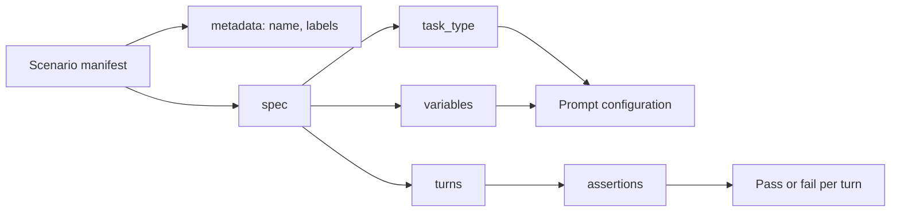

How to design LLM test scenarios that stay focused, readable and stable as models vary.

## What makes a good test scenario

A good scenario is clear (its purpose is obvious), focused (it tests one thing), realistic (it models an actual use case), maintainable (easy to update) and robust (it tolerates normal LLM variability). The sections below explain the design choices behind each quality.

## How a scenario fits together

A Scenario manifest names a `task_type` that selects the prompt configuration, lists the `turns` the user sends, and attaches assertions to the turns they judge.



See the [Scenario Format reference](/arena/reference/scenario-format/) for every field.

## Design patterns

### Single responsibility

Each scenario validates one behaviour. A scenario that greets, asks about refunds, asks for contact details and asks about opening hours fails for four unrelated reasons, and the failure does not say which. Focused scenarios are easier to debug, easier to maintain, and clearer as regression tests.

```yaml
apiVersion: promptkit.altairalabs.ai/v1alpha1
kind: Scenario
metadata:
  name: refund-policy-question
  labels:
    area: billing
    priority: high
spec:
  id: refund-policy-question
  task_type: support
  description: Customer asks about the refund policy
  turns:
    - role: user
      content: "What is your refund policy?"
      assertions:
        - type: content_includes
          params:
            patterns: ["refund", "policy"]
          message: Should mention the refund policy
```

### Arrange, act, assert

Treat each scenario as three phases. Arrange sets the inputs: `task_type`, `variables` and the preceding turns. Act is the model responding to the user turn. Assert is the checks on that response. Keeping the phases distinct makes it obvious which part to change when a scenario breaks.

### Progressive complexity

Start with a single turn and a single assertion, then add turns and layers once that passes. A scenario that begins as a 10-turn conversation gives no signal about where the first failure is. The progression has three levels. All three fragments sit under `spec:` and assume the prompt configuration for `task_type` declares a `user_name` template variable.

Level 1 sends one turn with no assertions, which proves the prompt and provider are wired up:

```yaml
turns:
  - role: user
    content: "Hi"
```

Level 2 adds a variable and one assertion on the response:

```yaml
variables:
  user_name: "Alice"
turns:
  - role: user
    content: "Hi"
    assertions:
      - type: content_includes
        params:
          patterns: ["Alice"]
        message: Should use the user name
```

Level 3 adds turns, so the later ones test whether the model keeps what an earlier turn said:

```yaml
turns:
  - role: user
    content: "Hi, I'm Alice"
  - role: user
    content: "What's my name?"
    assertions:
      - type: content_includes
        params:
          patterns: ["Alice"]
        message: Should remember the name from turn 1
```

### Edge case coverage

Cover the boundaries: empty input, very long input, special characters and non-English input. Give each edge case its own scenario and tag it with `labels` such as `kind: edge-case`, so you can run the edge cases together.

## Scenario organization

Group scenario files by purpose so a failing directory points at the area at fault:

```text
scenarios/
├── smoke/              # quick validation
├── customer-support/   # one file per feature area
├── edge-cases/         # input validation, error handling
└── regression/         # known issues
```

Each file holds one Scenario manifest, and the Arena config lists every file under `scenarios:` explicitly. Name files after the feature area (`customer-support.yaml`, `order-management.yaml`).

Tag scenarios with `metadata.labels`, which accepts string keys and values. Labels such as `area: billing` and `priority: critical` let you select and report on groups. Retire a scenario by removing it from the Arena config or by labelling it, since Scenario has no `deprecated` or `skip` field.

## Context and conversation history

Scenarios carry state in two ways. Explicit state is data you set up front, such as `variables` or `context_metadata`. Implicit state is the conversation history that earlier turns build up.

This fragment sits under `spec:`:

```yaml
turns:
  - role: user
    content: "My order number is 12345"
  - role: user
    content: "What's the status?"   # refers to the previous turn
```

Use explicit state for known facts and environment data. Use history when the point of the test is whether the model retains what was said earlier. `spec.context` is a free-form object that the engine does not pass to the model, so do not rely on it to steer a response. `promptarena validate` warns about a `context.variables` key for this reason. Two fields do reach the pipeline. `spec.variables` is a map of strings injected into the prompt's template variables. `spec.context_metadata` carries `domain` and `user_role`, which the engine turns into the `domain`, `user_context` and `user_role` template variables. When the history grows too long for the model, the [Manage Context](/arena/how-to/scenarios/manage-context/) how-to covers `context_policy` truncation.

## Assertion design

### Layered assertions

Stack checks from cheap to expensive: structure first (is the response non-empty and a sensible length), then content (does it contain the key facts), then quality (an `llm_judge` for tone or sentiment), then business rules. Cheap layers fail fast and tell you exactly what broke. The [Validate Outputs](/arena/how-to/scenarios/validate-outputs/) how-to lists the assertion types.

### Specificity

Pick the level that matches what you care about. A pattern like `.+` accepts anything, including a useless reply. An exact-sentence match breaks when the model rephrases. Checking that the reply mentions `refund` and `policy` validates the behaviour without pinning the wording.

### Negative assertions

Test what must not happen as well as what must. `content_excludes` fails the turn when any listed pattern appears, which is how you assert that a reply never mentions a competitor. Go regular expressions use RE2 and have no lookahead, so `(?!...)` does not compile.

This fragment sits under a turn in `spec.turns`:

```yaml
assertions:
  - type: content_excludes
    params:
      patterns: ["CompetitorA", "CompetitorB"]
    message: Must not mention competitors
  - type: llm_judge
    params:
      judge: default
      criteria: "Response keeps a professional tone"
    message: Must be professional
```

The `message` is a sibling of `params`. The `judge` value names an entry in the Arena config's `spec.judges`, and a name that `spec.judges` does not define fails when the config loads. Validation also rejects param names an assertion does not accept.

## Multi-turn design

Model conversations as natural progressions: a problem statement, information gathering, a solution attempt and a resolution, with assertions on the turns where behaviour matters rather than on every turn. Assertions on the final turn check where the conversation ended up. Assertions on intermediate turns check the path.

To test state transitions, assert on what the model says at each step (it asks for a destination, then a date, then confirms). To test branches, write one scenario per path: one where the customer is satisfied and one where they ask for a manager. Two short scenarios with a shared opening are easier to read than one that tries to cover both.

## Performance and cost

Balance coverage against speed and spend by running different scenario sets at different depths. Run a fast smoke set on the mock provider on every change to validate structure. Run a broader set on a cheaper model for regression. Reserve the expensive models and the full provider matrix for critical paths and pre-release runs.

The cost of a run scales with the number of scenarios, the number of turns, the number of providers and the model price. Fewer providers on short, targeted conversations cost the least.

## Maintenance

Keep scenarios maintainable by recording intent in `metadata.name`, `spec.description` and `labels`. Metadata accepts only `name`, `namespace`, `labels` and `annotations`, and a turn accepts only the fields in the Scenario Format reference. Any other key, such as a turn `name` or `context`, fails validation. Keep version history in git rather than in the manifest.

To avoid repeating a block of assertions, use a YAML anchor and alias. YAML anchors and merge keys both work in scenario files.

```yaml
apiVersion: promptkit.altairalabs.ai/v1alpha1
kind: Scenario
metadata:
  name: billing-conversation
  labels:
    area: billing
spec:
  id: billing-conversation
  task_type: support
  description: Billing questions that share one quality check
  turns:
    - role: user
      content: "Question about my bill"
      assertions: &helpful
        - type: llm_judge
          params:
            judge: default
            criteria: "Response is helpful and supportive"
          message: Must be helpful
    - role: user
      content: "Can I get a refund?"
      assertions: *helpful
```

## Anti-patterns

A god scenario packs dozens of turns that test unrelated features. When it fails you cannot tell why, so split it into focused scenarios. Hardcoded data repeated across scenarios drifts out of sync, so move shared values into `variables`.

## Related pages

- [Testing Philosophy](/arena/explanation/testing-philosophy/): why we test LLMs this way
- [Validation Strategies](/arena/explanation/validation-strategies/): choosing assertions
- [Provider Comparison](/arena/explanation/provider-comparison/): testing across providers
- [Write Scenarios](/arena/how-to/scenarios/write-scenarios/): the practical guide
- [Scenario Format](/arena/reference/scenario-format/): every field
