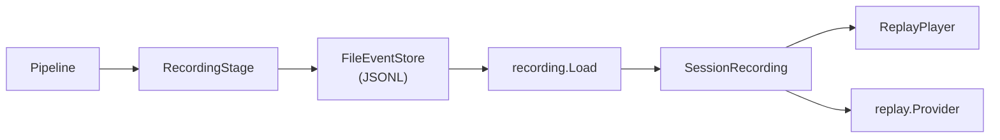
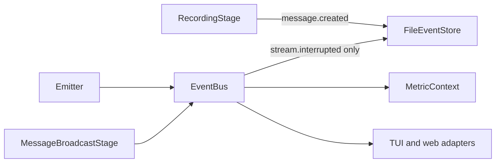
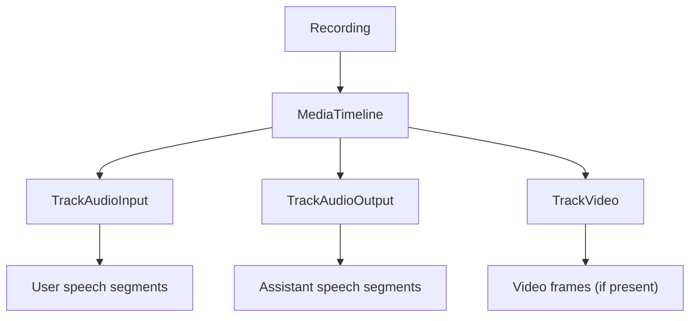

This document explains how Arena's session recording system captures, stores, and replays LLM conversations.

## Overview

Session recording provides an audit trail of LLM interactions. Unlike simple logging, recordings capture:

- Nanosecond-resolution event timestamps
- Every message with its multimodal parts, tool calls and tool results
- Enough information to replay a conversation turn by turn

Arena writes a recording when `defaults.output.recording.enabled` is `true`. Arena adds `RecordingStage` to the pipeline itself, duplex runs included. On the duplex path the provider stage puts each assistant turn's message on the element that ends the turn, which `RecordingStage` skips as a control signal, so Arena records a copy of that content immediately ahead of it. The duplex recording sits after the pack guardrail stage, so a recorded turn holds the enforced content.

The following diagram shows the path from a live run to a replay.



## Event-Driven Architecture

### Event Emitter

The `Emitter` publishes events to the EventBus as they occur during a conversation. `events.NewEmitter` takes the bus, an execution ID, a session ID and a conversation ID. Arena passes the run ID as both the execution ID and the session ID.

`RecordingStage` does not use the Emitter or the EventBus. It appends `message.created` events straight to the `EventStore`. Each user message is recorded once.

:::note[Binary data handling]
The emitter's `MessageCreated()` strips binary data (base64 `Data` and `FilePath`) from content parts and emits only metadata (MIMEType, SizeKB, dimensions). This keeps observability events lightweight.

`RecordingStage` writes to the store with full binary data intact.
:::

Two routes reach the event store and the other subscribers, as the following diagram shows.



The EventBus carries the `conversation.started`, `message.created`, `message.updated`, `audio.input`, `audio.output`, `provider.call.started`, `provider.call.completed`, `provider.call.failed`, `tool.call.started`, `tool.call.completed`, `tool.call.failed`, `validation.started`, `validation.passed` and `validation.failed` families that feed the TUI, the web adapters and `MetricContext`.

The `FileEventStore` is the only bus subscription that writes recordings, and it receives `stream.interrupted` events from the bus. Message events reach it through `RecordingStage`. The bus copy of `message.created` comes from `MessageBroadcastStage`.

### Event Types

An Arena recording holds three event types: `message.created`, `stream.interrupted` and `audio.output`. Every run writes the first two; `audio.output` comes from a duplex run, or from a streaming text turn whose provider streams audio back. `RecordingStage` can also write `audio.input`, `message.text.delta`, image and video events, but Arena's pipelines never produce them: the duplex pipeline records only its output, and Arena leaves streaming-text and video recording off. See [Captured Events](/arena/how-to/scenarios/session-recording/#captured-events) for the table. Tool calls, tool results and media parts are fields of the `message.created` payload, not separate events.

### Event Structure

Each event carries a type, a timestamp, an execution ID, a session ID, a conversation ID, a user ID, a sequence number that gives ordering, a span context and an event-specific payload. The payload has type `events.EventData`, a marker interface implemented by each event's data type.

## Eval Integration

Arena evaluates the live conversation through its `EvalOrchestrator`, not the recording file. At the end of each conversation, text and duplex runs alike, the orchestrator runs every pack eval trigger synchronously over the message list: the turn triggers (`every_turn`, `sample_turns`) once per assistant turn, then the session triggers (`on_session_complete`, `sample_sessions`), then `on_conversation_complete`.

Pack eval results land in `ConversationResult.EvalResults` and the report. For details on eval types and configuration, see [Eval Framework](/arena/explanation/eval-framework/).

## Storage Format

### FileEventStore

Events are persisted in JSONL (JSON Lines) format, one file per run at `<out>/recordings/<run-id>.jsonl`:

```jsonl
{"seq":1,"event":{"type":"message.created","timestamp":"2024-01-15T10:30:00Z",...}}
{"seq":2,"event":{"type":"message.created","timestamp":"2024-01-15T10:30:00.1Z",...}}
{"seq":3,"event":{"type":"stream.interrupted","timestamp":"2024-01-15T10:30:00.2Z",...}}
```

The format is append-only, so concurrent writes are safe. You can stream it without loading the whole file, and you can read it by eye when debugging.

### SessionRecording Format

For export/import, recordings use a structured format. The first line holds the metadata under a `metadata` key, and each event line nests the event under an `event` key. Offsets and durations are integer nanosecond counts:

```jsonl
{"type":"metadata","metadata":{"session_id":"...","start_time":"...","duration":300000000,...}}
{"type":"event","event":{"seq":1,"type":"message.created","offset":100000000,...}}
{"type":"event","event":{"seq":2,"type":"message.created","offset":200000000,...}}
```

The loader auto-detects both formats:

```go
rec, err := recording.Load("session.jsonl")  // Works with either format
```

## Media Timeline

For recordings with audio or video events, the `MediaTimeline` provides synchronized access. A text run whose provider returns no audio writes only `message.created` and `stream.interrupted` events, so a timeline built from its recording holds no audio tracks. A duplex recording carries `audio.output` events, which fill the assistant audio track.



### Track Structure

Each track contains time-ordered segments. A `MediaSegment` has a `StartTime` and a `Duration` (both `time.Duration`), a `Payload` (inline bytes in `Payload.InlineData`, or a storage reference), and `Metadata`. For audio, `Metadata` is an `events.AudioMetadata` with `SampleRate`, `Channels`, `Encoding`, `BitsPerSample` and `DurationMs`.

### Audio Reconstruction

`ExportAudioToWAV` exports a track as a standard WAV file. It collects all segments for the track, concatenates the PCM data in time order, writes a RIFF/WAVE header with the format info and outputs 16-bit PCM. See [Synchronized Playback](/arena/how-to/scenarios/session-recording/#synchronized-playback) for the code.

## Replay System

### ReplayPlayer

The `ReplayPlayer` provides time-synchronized access to a loaded recording: you seek to a position and read the state there. See [Synchronized Playback](/arena/how-to/scenarios/session-recording/#synchronized-playback) for the code.

### Playback State

At any position the player reports the current events, recent events, accumulated messages, audio activity and active annotations. See [Synchronized Playback](/arena/how-to/scenarios/session-recording/#synchronized-playback) for the field table.

### Annotation Correlation

Annotations attach to a session, a time range or an event, and the player includes the active ones in each state query. See [Add Annotations](/arena/how-to/scenarios/session-recording/#add-annotations) for the code.

## Replay Provider

For deterministic replay, the `replay.Provider` simulates the original provider. It returns the recorded assistant responses turn by turn, offline. See [Replay Provider](/arena/how-to/scenarios/session-recording/#replay-provider) for the code.

The replay provider supports regression testing against known-good responses, reproducing exact conversation flows when debugging, and offline testing without API calls.

## Performance Considerations

`RecordingStage` appends each event synchronously under a mutex, so a slow disk back-pressures the pipeline. Disk use grows with conversation length. Base64 encoding adds about 33% to binary parts. A duplex recording also holds the provider's audio as `audio.output` events, so it grows with talk time.

Recording is a global switch (`defaults.output.recording.enabled` and `dir`). There is no retention policy or per-scenario setting. See [Recording Storage](/arena/how-to/scenarios/session-recording/#recording-storage) for housekeeping tips.

## Next Steps

- [Session Recording How-To](/arena/how-to/scenarios/session-recording/): practical usage guide
- [Duplex Architecture](/arena/explanation/duplex-architecture/): voice conversation system
- [Testing Philosophy](/arena/explanation/testing-philosophy/): why test prompts
