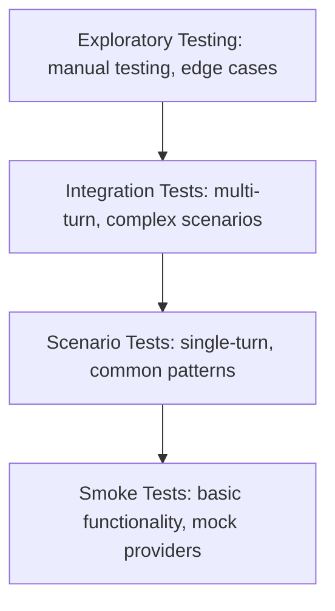
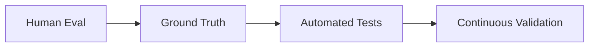

PromptArena asserts on the behavior of a model's response and leaves its exact wording free. This page explains the reasoning behind that choice and the design decisions that follow from it.

## Equality checks fail on correct LLM answers

Traditional tests assume the same input gives the same output. An LLM given "Greet the user" can answer "Hello! How can I help?", "Hi there! What can I do for you?" or "Greetings! How may I assist you today?". Each response is valid and each is different, so an equality check fails on correct answers.

## Core testing principles

### Behavioral testing over exact matching

Assert on the behavior you need: the response acknowledges the contact, sounds professional, stays positive. Pin exact wording only when the wording is the requirement.

```yaml
# Brittle: exact match
assertions:
  - type: content_matches
    params:
      pattern: "^Thank you for contacting AcmeCorp support\\.$"
    message: "Exact wording required"

# Robust: behavior validation
assertions:
  - type: content_includes
    params:
      patterns: ["thank", "AcmeCorp", "support"]
    message: "Must acknowledge contact"
  - type: llm_judge
    params:
      criteria: "Response has a professional tone"
      judge: quality-judge
    message: "Must be professional"
```

The `message` field sits next to `params` and supplies the failure text. `content_includes` matches case-insensitively and passes only when every listed pattern appears. `llm_judge` picks its judge with `params.judge` (a name from the Arena config's `spec.judges`) or `params.provider` (a provider id), and `params.judge` works the same in an objective's `success` and `rewind.when` and a persona's `transitions[].when`. LLMs generate varied responses, so testing behavior leaves room for variation while still catching real regressions.

### Multi-dimensional quality

LLM quality is more than a single pass or fail. A response can be accurate and rude, polite and wrong, or correct and too slow. A scenario can cover correctness, relevance, tone, safety, consistency across turns and performance, each with the assertion type that fits it:

```yaml
assertions:
  - type: content_includes   # Correctness
    params:
      patterns: ["30-day return"]
    message: "Must mention return policy"

  - type: llm_judge          # Tone
    params:
      criteria: "Response is helpful and supportive"
      judge: quality-judge
    message: "Must be helpful"

  - type: content_matches    # Safety: fails if either word appears
    params:
      pattern: "offensive|inappropriate"
      expect_match: false
    message: "Must not contain inappropriate content"

  - type: is_valid_json      # Format
    message: "Response must be valid JSON"
```

Go's regular expression engine (RE2) has no lookahead, so a "must not contain" check uses `expect_match: false` rather than a negative lookahead pattern.

### Comparative testing

Absolute correctness is hard to define, so relative comparison is often the more useful measure. Useful comparisons are across providers (OpenAI, Claude and Gemini on the same scenario), across model versions (a larger model against a cheaper one), across time (a regression shows up as a change from the last run) and against human judgment, which supplies the ground truth that automated checks approximate.

A scenario lists the providers it runs against, and every provider produces its own result:

```yaml
spec:
  providers: [openai-gpt4, claude-sonnet, gemini-pro]
```

The comparison then shows which provider handles edge cases better, which is faster and which costs less.

### Contextual validation

The same question can need a different answer depending on who is asking. Two scenario fields carry that audience into the prompt. `spec.variables` supplies template variables that are rendered into the prompt, and a scenario's values override variables of the same name from the prompt config. `spec.context_metadata` with `domain` and `user_role` fills the `domain`, `user_role` and `user_context` template variables.

```yaml
# Fragment: a developer audience; the prompt template references {{user_type}}
spec:
  variables:
    user_type: developer
  context_metadata:
    user_role: developer
```

You express two audiences as two scenarios. The developer scenario asserts on `"code"`, `"debug"` and `"solution"` with `content_includes`, and the general-user scenario asserts a beginner-friendly tone with `llm_judge`.

### Failures across runs show patterns

A failing assertion is a bug report, and many runs of them show more. They reveal which kinds of queries fail, where models struggle with edge cases, how quality changes over time and which provider handles which task best.

## Testing strategies

### Layered testing pyramid

Tests are layered by cost and breadth, from cheap smoke tests at the base to exploratory work at the top.



Smoke tests run on mock providers and check that configuration, scenario structure and assertions load. Scenario tests cover the common user journeys with expected inputs. Integration tests add multi-turn conversations and tool calling. Exploratory testing is human-driven: adversarial prompts, creative edge cases and open-ended quality assessment.

### Progressive validation

Start with structural checks, then add content, quality and business-rule assertions as a scenario matures. [Validation strategies](/arena/explanation/validation-strategies/) describes the layers and how to combine them.

When a business rule needs logic that no built-in assertion expresses, `rest_eval` calls an external REST endpoint, `a2a_eval` delegates to an A2A evaluator, and an exec handler runs an external command.

## Design decisions

### Scenarios are YAML manifests

Scenarios are Arena's own Kubernetes-style manifests (`apiVersion: promptkit.altairalabs.ai/v1alpha1`, `kind: Scenario`), written in YAML. PromptPacks are a separate artifact: `packc` compiles prompts into them, and they have no scenario concept.

YAML keeps diffs readable in Git, lets scenarios go through code review, and lets people who do not write Go author and read test cases.

### Providers are abstracted from scenarios

Scenarios name provider ids and never hard-code a vendor. The Arena config's `providers:` list points at `kind: Provider` manifests, and each manifest holds the `type` and `model`:

```yaml
# arena config
providers:
  - file: providers/openai.yaml
  - file: providers/claude.yaml
  - file: providers/gemini.yaml
```

The provider `type` values include `openai`, `claude` and `gemini`. The same scenario runs on each, so you can switch providers, optimize cost and avoid depending on a single vendor.

### Assertions are declarative

```yaml
# Declarative (PromptArena)
assertions:
  - type: content_includes
    params:
      patterns: ["customer service"]
    message: "Must mention customer service"

# Imperative (traditional)
# assert "customer service" in response
```

Declarations let non-programmers write tests, apply the same validation across scenarios, and give the reporter structured failures instead of a stack trace.

### Mock providers answer from memory

Mock providers make no network calls. That gives fast configuration checks, no spend while iterating, offline development and quick CI validation.

`--mock-provider` replaces each reply with a generic mock response ("Mock response from provider") unless a mock config supplies responses, so content assertions see that text and a mock run verifies structure. [Use mock providers](/arena/how-to/providers/use-mock-providers/) covers the flags and mock config.

## Anti-patterns to avoid

### Over-specification

A pattern like `^Thank you for contacting support\. Our business hours are 9am-5pm\.$` breaks on any wording change. Assert the required facts and judge the tone instead:

```yaml
assertions:
  - type: content_includes
    params:
      patterns: ["thank", "support", "business hours"]
    message: "Must acknowledge support contact"
  - type: llm_judge
    params:
      criteria: "Response has a professional tone"
      judge: quality-judge
    message: "Must be professional"
```

### Under-specification

A lone `content_matches` with `pattern: ".+"` accepts any non-empty output, including garbage. Combine the emptiness check with required content and a judged quality criterion. A length check such as `^.{50,}$` does not match multi-line replies because `.` excludes newlines. Use `(?s)^.{50,}$` for those.

### Flaky tests

A pattern that assumes a layout, such as `^Hello.*\nHow can I help\?$`, fails whenever the model reformats its greeting. Check for `"hello"` and `"help"` with `content_includes`, and judge the welcoming tone with `llm_judge`.

### Coupling tests to implementation

Asserting that the model called `calculate` with `operation: multiply` couples the test to one implementation path:

```yaml
conversation_assertions:
  - type: tool_calls_with_args
    params:
      tool_name: calculate
      expected_args:
        operation: multiply
        x: 2
        y: 2
    message: "Must pass exact args"
```

Tool assertions are right when the call itself is the requirement, such as an agent that must call a refund tool. When the requirement is the answer, assert the outcome:

```yaml
assertions:
  - type: content_includes
    params:
      patterns: ["4"]
    message: "Must provide correct answer"
  - type: llm_judge
    params:
      criteria: "Response correctly states that 2 times 2 equals 4"
      judge: quality-judge
    message: "Must be factually correct"
```

## Quality metrics

Each run records response latency and API cost, and across `spec.trials` it records a per-scenario `pass_rate`: the fraction of trials where every assertion passed. The run index reports `total_runs`, `successful` and `errors`. Beyond those, the signals worth tracking are failure patterns by query type, provider comparisons and whether results are improving or degrading between runs.

### Setting thresholds

Arena has no threshold configuration block. The gate is the exit code of `promptarena run --ci`; [Run in CI](/arena/how-to/interfaces/run-in-ci/) covers wiring it into a pipeline.

## Testing in production

### A/B testing LLM changes

To compare a baseline prompt with a candidate, run both versions as separate configs and compare the `index.json` that `--format json` writes (`successful`, `errors`, `total_cost`). Running with `spec.trials` above 1 adds per-assertion pass rates, which smooths out run-to-run variation.

## The human factor

### When to use human evaluation

Automated checks cannot settle everything. Human judgment covers subjective quality, creative content, nuanced errors that are technically correct but contextually wrong, and benchmark creation, where a person supplies ground truth for the automated tests.

Human evaluation produces ground truth, ground truth shapes the automated tests, and the automated tests then validate continuously.



### Human-in-the-loop testing

Arena has no human-evaluation step. To route scenarios to a person, tag them with `metadata.labels` (for example `review: human`); labels are carried into reports, and your own review step in CI picks those scenarios up.

## Further reading

- [Scenario design principles](/arena/explanation/scenario-design/) covers how to structure test scenarios.
- [Provider comparison guide](/arena/explanation/provider-comparison/) covers provider differences.
- [Validation strategies](/arena/explanation/validation-strategies/) covers choosing assertions.
