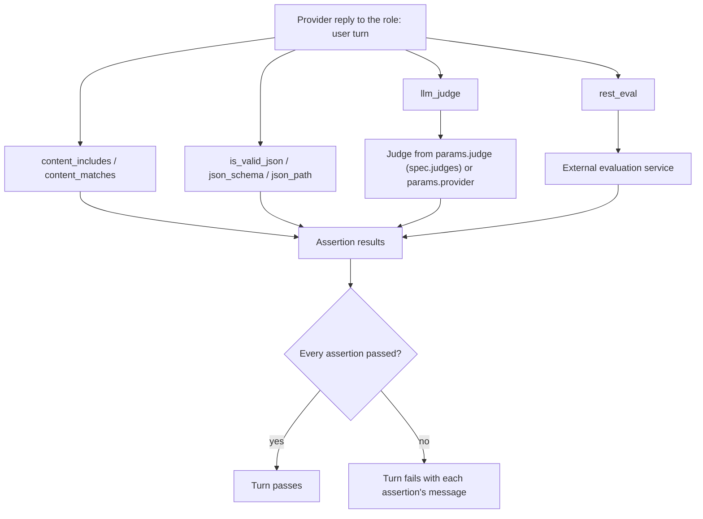

How to design assertions that accept the many correct answers an LLM can give and still catch the wrong ones.

## The validation challenge

LLM outputs are non-deterministic and variable, so exact-match testing breaks:

```yaml
# Fragment: too rigid
assertions:
  - type: content_matches
    params:
      pattern: "^The capital of France is Paris\\.$"
    message: "Exact match required"

# The model might say:
# - "Paris is the capital of France."
# - "The capital of France is Paris, France."
# - "France's capital city is Paris."
```

The core challenge is to validate intent and correctness without demanding exact wording.

## How a turn's assertions run

Each turn's assertions run against the reply to that turn. Deterministic checks read the response text directly, while `llm_judge` calls a judge provider and `rest_eval` calls an external service.



Put assertions on the `role: user` turn. A turn's role is `user` or a self-play role ID, so `promptarena validate` rejects a `role: assistant` turn.

## Validation principles

### Test behavior

Check what the response achieves rather than how it is phrased:

```yaml
# Fragment: tests behavior
assertions:
  - type: content_includes
    params:
      patterns: ["Paris"]
    message: "Should mention Paris"

# Fragment: tests exact wording
assertions:
  - type: content_matches
    params:
      pattern: "^The capital is Paris$"
    message: "Exact match"
```

### Layer your validations

Combine validation types from loose to strict:

```yaml
# Fragment
assertions:
  # Layer 1: basic content presence
  - type: content_includes
    params:
      patterns: ["key", "terms"]

  # Layer 2: structural validation
  - type: is_valid_json

  # Layer 3: schema validation
  - type: json_schema
    params:
      schema:
        type: object
        required: ["expected_field"]

  # Layer 4: pattern matching
  - type: content_matches
    params:
      pattern: "business_rule_pattern"
```

All assertions on a turn must pass. For OR logic, use regex alternation inside one `content_matches`.

### Tolerate variation

Accept legitimate variation in wording:

```yaml
# Fragment: flexible
assertions:
  - type: content_matches
    params:
      pattern: "(refund|money back|return funds)"
    message: "Should mention refund option"

# Fragment: too rigid
assertions:
  - type: content_includes
    params:
      patterns: ["refund policy"]
    message: "Must say exactly 'refund policy'"
```

### Fail fast, fail clear

Give every assertion a top-level `message` that says what is wrong. Only that key is read; a `message` inside `params` is ignored, and `promptarena validate` warns about it.

`promptarena validate` also checks each assertion's `params` against what its type reads. A key the type ignores, such as `case_sensitive` on `content_matches`, is an error, as is a scalar where a list is needed (`patterns: "Paris"` instead of `patterns: ["Paris"]`).
```yaml
# Fragment
assertions:
  - type: content_includes
    params:
      patterns: ["critical_info"]
    message: "Missing required policy information"
```

## Validation types

Each type answers a different question, and each has a blind spot.

### String contains

`content_includes` checks that required terms appear in the response, and `content_matches` checks a regular expression. See the [assertions reference](/arena/reference/assertions/) for the parameters of both.

Use them to test for required information, verify that key terms appear and check compliance with instructions. They do not validate meaning, cannot detect context misuse and ignore word order.

### Regular expressions

Patterns suit structured content such as dates, email addresses and identifiers. See the [assertions reference](/arena/reference/assertions/) for the syntax.

- Keep patterns simple.
- Use anchors (`^`, `$`) carefully, because an anchored pattern must match the whole response.
- Test the pattern against several phrasings.

### String length

Prefer `min_length` and `max_length` for length limits. A regex such as `^.{50,200}$` never matches a multi-line response, because `.` does not match a newline.

```yaml
# Fragment: a concise reply
assertions:
  - type: min_length
    params:
      min: 50
  - type: max_length
    params:
      max: 400
    message: "Reply should stay under 400 characters"
```

Length checks enforce conciseness, ensure completeness and test summarization.

### Semantic validation

Where wording varies but meaning must hold, three assertion types compare meaning. `llm_judge` asks a judge model to grade the reply against a rubric. `cosine_similarity` scores embedding similarity between the output and a reference. `outcome_equivalent` checks whether two outputs are semantically equivalent. Combining several content assertions is the cheaper alternative for paraphrased responses, key-information checks and contextually relevant terms.

### Sentiment and tone

Keyword patterns approximate tone. A `content_matches` for `(?i)(understand|help|sorry|apologize)` checks that a reply to a frustrated user shows empathy:

```yaml
# Fragment
assertions:
  - type: content_matches
    params:
      pattern: "(?i)(understand|help|sorry|apologize)"
    message: "Should acknowledge the user's frustration"
```

A keyword check sees only the words, so use `llm_judge` when the tone itself matters.

Tone checks apply to customer support, empathy, brand voice and professional language.

### Structural validation

`is_valid_json` checks that the response parses, and `json_schema` checks it against a schema. An extraction turn combines them:

```yaml
# Fragment
assertions:
  - type: is_valid_json
  - type: json_schema
    params:
      schema:
        type: object
        required: ["name", "email"]
        properties:
          email: { type: string, format: email }
```

See the [assertions reference](/arena/reference/assertions/) for `json_path`. Use these checks for structured output, API responses and data extraction.

### List and format checks

Ordered-item regexes check lists, and patterns check Markdown, HTML and code fences. A numbered list needs at least three items:

```yaml
# Fragment
assertions:
  - type: content_matches
    params:
      pattern: '(?s)1\..*2\..*3\.'
    message: "Expected a numbered list of at least three items"
```

These checks suit enumeration tasks, option lists and recommendations. In a double-quoted YAML scalar, `\*` is an invalid escape, so write regexes containing backslashes in single quotes.

### Negative validation

To test what must not appear, use `content_not_includes` or a `content_matches` with `expect_match: false`:

```yaml
# Fragment
assertions:
  - type: content_not_includes
    params:
      patterns: ["inappropriate", "offensive"]
    message: "Response must not contain inappropriate content"

  - type: content_matches
    params:
      pattern: '\b\d{3}-\d{2}-\d{4}\b'
      expect_match: false
    message: "Should not contain an SSN"
```

Go regular expressions (RE2) have no lookahead. A pattern such as `^(?!.*word).*$` fails to compile and the turn errors whatever the response says.

Negative checks test content filtering, prevent data leakage and validate safety guardrails. A no-PII scenario is the SSN check above with an email pattern beside it, applied on every turn where the user might provoke a leak.

### Multi-turn validation

Coherence across turns is validated by asserting on later turns. See [Write scenarios](/arena/how-to/scenarios/write-scenarios/) for a multi-turn scenario.

A consistency check combines a content check with an LLM judge:

```yaml
# Fragment
assertions:
  - type: content_includes
    params:
      patterns: ["Alice"]
    message: "Should reference earlier context"

  - type: llm_judge
    params:
      criteria: "Response is consistent with earlier conversation context"
      judge: "default"
    message: "Must maintain consistency"
```

`judge` names an entry in `spec.judges`. You can set `params.provider` instead.

## Validation patterns

### The pyramid pattern

Layer validations from basic to advanced: non-empty, required terms, structure, semantics through `llm_judge`, business rules, then an external `rest_eval` service for specialised checks.

- Fast failure on basic issues
- Detailed validation only if basics pass
- Clear failure diagnostics
- Efficient test execution
- External services can apply specialized evaluation logic

### The specificity spectrum

Balance between too loose and too strict:

- Start specific, loosen as needed.
- Add constraints incrementally.
- Test with real LLM variations.
- Balance precision and recall.

### The safety net pattern

Several validations catch different failures in the same turn: a content pattern for the expected answer, `is_valid_json` for format and `json_path` for a required field.

### The progressive validation pattern

Validate incrementally through a conversation: confirm the order started, then that an item was added, then that checkout completed. See [Write scenarios](/arena/how-to/scenarios/write-scenarios/) for a multi-turn example.

## Advanced techniques

### Multiple assertions

All assertions on a turn must pass (implicit AND).

### Context-aware validation

An assertion's `when` key makes it conditional on a tool-call precondition (`tool_called`, `tool_called_pattern`, `any_tool_called` or `min_tool_calls`). Arena cannot gate an assertion on a context variable. To vary expectations by user type, write one Scenario file per case and put the case in `spec.variables`. See [Write scenarios](/arena/how-to/scenarios/write-scenarios/).

### Statistical validation

A model that answers correctly nine times in ten passes a single run most of the time and fails the tenth. `spec.trials` runs the scenario that many times so the rate is measured instead of sampled once:

```yaml
# Fragment
spec:
  trials: 10
  turns:
    - role: user
      content: "What is the refund window?"
      assertions:
        - type: content_includes
          params:
            patterns: ["30 days"]
          pass_threshold: 0.9
```

With `spec.trials` above 1, Arena aggregates each assertion's results across trials into a pass count, a fail count, a pass rate and a flakiness score. An assertion passes when its pass rate meets its `pass_threshold`, a number from 0 to 1 that sits beside `type` and `params`. An assertion with no `pass_threshold` must pass in every trial (a threshold of 1.0). In the fragment above, 9 passes in 10 trials meets 0.9, and 8 does not.

The flakiness score is `1 - |2 * pass_rate - 1|`. An assertion that always passes or always fails scores 0, and one that passes half the time scores 1, so it separates a consistent failure, which points at the prompt or the assertion, from an unstable one, which points at the model's variance. A trial that errors for a reason other than a failing turn assertion counts as a failure for every assertion it never reached. `pass_threshold` is a pass-rate knob and has no relation to the score threshold of a judged signal such as `llm_judge`.

## Best practices

### Start simple, add complexity

Begin with a content check, then add semantic and format checks as the scenario matures.

### Test your validations

Run assertions against known good and bad responses before relying on them. With `--mock-provider` and a mock-responses file, write one canned reply that should pass and one that should fail, run both, and confirm each assertion reports the verdict you expect. An assertion that passes on a wrong reply is too loose, and one that fails on a correct reply is too strict.

### Balance precision and recall

```yaml
# Fragment: high precision (few false positives), exact pattern
assertions:
  - type: content_matches
    params:
      pattern: "^The specific answer is: [A-Z]$"
    message: "Must match exact format"

# Fragment: high recall (few false negatives), matches any option
assertions:
  - type: content_matches
    params:
      pattern: "(answer1|answer2|answer3)"
    message: "Must contain at least one answer"

# Fragment: balanced, specific but flexible
assertions:
  - type: content_includes
    params:
      patterns: ["answer", "option"]
    message: "Must discuss answer or option"
```

### Before finalizing assertions

A finished set of assertions tests the core requirement, tolerates legitimate variation in wording and still fails on real errors. Each failure carries a message that says what went wrong. The set should hold across providers, cover safety and compliance requirements, and include edge cases.

## Further reading

- [Testing Philosophy](/arena/explanation/testing-philosophy/) covers core testing principles.
- [Scenario Design](/arena/explanation/scenario-design/) covers designing effective scenarios.
- [Provider Comparison](/arena/explanation/provider-comparison/) covers cross-provider testing.
- [Checks Reference](https://promptkit.altairalabs.ai/reference/checks/) lists all check types and parameters.
- [Assertions Reference](/arena/reference/assertions/) gives assertion syntax and configuration.
- [Guardrails Reference](/arena/reference/validators/) covers runtime policy enforcement.
- [Unified Check Model](https://promptkit.altairalabs.ai/concepts/validation/) explains how assertions, guardrails, and evals relate.
