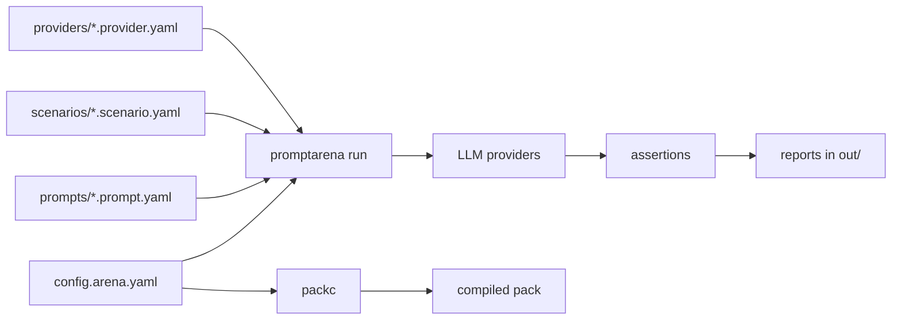

PromptArena is a testing framework for LLM prompts and agents. You describe prompts, providers and scenarios in YAML, and `promptarena run` executes every scenario against every provider and checks the responses.


## What it does

- Runs the same prompt across providers such as OpenAI, Claude and Gemini, or against a mock provider that makes no API calls.
- Drives multi-turn conversations and checks each turn with assertions.
- Reports latency, token usage, cost and pass/fail rates per run.
- Writes JSON, JUnit, Markdown, CSV and objectives reports, and exits non-zero in CI mode when a run fails.

## How a run works

Arena reads a config that points at prompts, providers and scenarios, runs each scenario against each selected provider, evaluates the assertions, and writes reports to the output directory. `packc` compiles the same tested prompts into a pack for production.



## Quick start

Install PromptArena, generate a project and run it:

```bash
brew install altairalabs/tap/promptarena

# Or build from source with Go (needs a C compiler + audio dev headers)
go install github.com/AltairaLabs/promptarena/v2/arena/cmd/promptarena@latest

promptarena init my-test --quick
cd my-test
promptarena run
```

`--quick` does not prompt. It uses the template defaults, with the `mock` provider unless you pass `--provider`. The choices are `mock`, `openai`, `claude` and `gemini`. With `--provider mock` the project contains:

- `config.arena.yaml`
- `prompts/assistant.prompt.yaml`
- `providers/mock.provider.yaml`
- `scenarios/basic-test.scenario.yaml`
- `mock-responses.yaml`
- `.gitignore`
- `README.md`

Run `promptarena init my-project` without `--quick` for the interactive wizard, which asks for a project name, a provider and whether to create a `.env.example` file listing the API keys to export. The built-in templates are `quick-start` (the default), `customer-support`, `code-assistant`, `content-generation`, `multimodal` and `mcp-integration`.

Continue with [Your First Test](/arena/tutorials/01-first-test/), or see [Installation](/arena/how-to/setup/installation/) for other install options.

## Configuration at a glance

An Arena config lists provider files and scenario files:

```yaml
apiVersion: promptkit.altairalabs.ai/v1alpha1
kind: Arena
metadata:
  name: cross-provider-test

spec:
  providers:
    - file: ./providers/openai.yaml
    - file: ./providers/claude.yaml
    - file: ./providers/gemini.yaml

  scenarios:
    - file: ./scenarios/quantum-test.yaml
```

A scenario restricts itself to some providers with its own `spec.providers` list. An empty list means every provider in the Arena config. Assertions attach to turns, and `message` sits beside `params`:

```yaml
apiVersion: promptkit.altairalabs.ai/v1alpha1
kind: Scenario
metadata:
  name: quantum-test

spec:
  turns:
    - role: user
      content: "Explain quantum computing"
      assertions:
        - type: content_includes
          params:
            patterns: ["quantum"]
          message: "Should mention quantum"

        - type: content_matches
          params:
            pattern: "(qubit|superposition|entanglement)"
          message: "Should mention key quantum concepts"
```

In CI, `promptarena run --ci` exits non-zero when a run errors or an assertion fails:

```yaml
# .github/workflows/test-prompts.yml
- name: Test Prompts
  run: promptarena run --ci
```

## Who uses it

Prompt engineers use it to refine prompts and compare variations across providers. QA teams use it to catch regressions and produce reports. ML Ops teams run it in CI and compare provider cost and quality over time.

## Documentation by type

### Tutorials

- [Your First Test](/arena/tutorials/01-first-test/)
- [Multi-Provider Testing](/arena/tutorials/02-multi-provider/)
- [Multi-Turn Conversations](/arena/tutorials/03-multi-turn/)
- [MCP Tool Integration](/arena/tutorials/04-mcp-tools/)
- [CI/CD Integration](/arena/tutorials/05-ci-integration/)

### How-to guides

- [Installation](/arena/how-to/setup/installation/)
- [Build with an AI coding agent](/arena/how-to/agents/build-with-an-ai-agent/)
- [Write Test Scenarios](/arena/how-to/scenarios/write-scenarios/)
- [Configure Providers](/arena/how-to/providers/configure-providers/)
- [Use Mock Providers](/arena/how-to/providers/use-mock-providers/)
- [Validate Outputs](/arena/how-to/scenarios/validate-outputs/)
- [Run in CI](/arena/how-to/interfaces/run-in-ci/)
- [Session Recording](/arena/how-to/scenarios/session-recording/)

### Explanation

- [Testing Philosophy](/arena/explanation/testing-philosophy/)
- [Scenario Design](/arena/explanation/scenario-design/)
- [Provider Comparison](/arena/explanation/provider-comparison/)
- [Validation Strategies](/arena/explanation/validation-strategies/)
- [Session Recording](/arena/explanation/session-recording/)

### Reference

- [CLI Commands](/arena/reference/cli-commands/)
- [Configuration Schema](/arena/reference/config-schema/)
- [Scenario Format](/arena/reference/scenario-format/)
- [Assertions](/arena/reference/assertions/)
- [Validators](/arena/reference/validators/)
- [Pack Evals](/arena/reference/pack-evals/)
- [Output Formats](/arena/reference/output-formats/)

## Deploy

`promptarena deploy` ships prompt packs to cloud providers through adapter plugins.

- [Deploy Overview](/arena/explanation/deploy/overview/)
- [First Deployment Tutorial](/arena/tutorials/deploy/first-deployment/)
- [Multi-Environment](/arena/tutorials/deploy/multi-environment/)
- [Install Adapters](/arena/how-to/deploy/install-adapters/)
- [Plan and Apply](/arena/how-to/deploy/plan-and-apply/)
- [Deploy CLI Commands](/arena/reference/deploy/cli-commands/)

## Examples

- [Customer Support Testing](/arena/examples/customer-support/)
- [MCP Chatbot Testing](/arena/examples/mcp-chatbot/)
- [Guardrails Testing](/arena/examples/guardrails-test/)
- [Multi-Provider Comparison](/arena/examples/customer-support-integrated/)

## Getting help

- [First Test Tutorial](/arena/tutorials/01-first-test/)
- [Arena Examples](/arena/examples/)
- [Report a bug](https://github.com/AltairaLabs/promptarena/issues)

## Related tools

- [PackC](/packc/) compiles tested prompts for production.
- [SDK](https://promptkit.altairalabs.ai/sdk/) uses tested prompts in applications.
- [Complete workflow](/) shows all the tools together.
