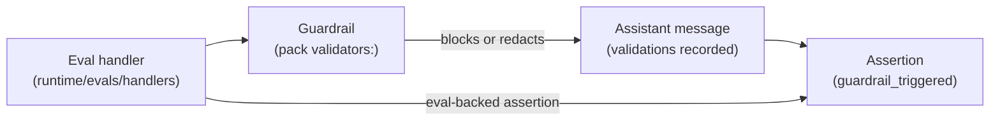

PromptArena is a testing framework for LLM-driven systems. It scores responses with eval primitives and turns those scores into pass/fail assertions. It covers a surface that frameworks built for single-turn evaluation do not reach:

- Voice: duplex audio with self-play personas, runtime tools, and assertions on what the agent said and how fast.
- Multi-turn agents: scripted or self-play users over many turns, with conversation-outcome assertions.
- Workflows: state machines as first-class test subjects.
- Multi-agent (A2A): supervisor and specialist delegation, asserted per turn.
- Guardrails as test signals: production-side guardrails observed with `guardrail_triggered`. The same code enforces in production and produces the test signal.

It also ships the standard eval-primitive catalog (faithfulness, hallucination, contextual recall and others), so if you already work in DeepEval or Ragas vocabulary you will find the names you expect. Scenarios use them as assertions.

This page is organised by use case, and most sections link to a runnable demo.

## Test a voice agent end to end

A transcript is a lossy record of a voice call. It does not carry turn-taking, latency, expressiveness or tool calls made during audio, so scoring the transcript alone leaves the voice-specific behaviour untested.

PromptArena tests voice as a full conversation:

- A persona (LLM-driven via self-play, or scripted text) drives the user side. TTS turns the persona's lines into audio, so the agent hears speech as it would on a real call.
- The agent under test is a real duplex provider (OpenAI Realtime, Gemini Live) or a mock for CI.
- Per-turn latency budgets and content checks run on real signals.

The duplex voice pipeline runs the pack's output guardrails on each completed assistant turn, after the realtime provider has streamed it, so a firing is recorded and asserted but the audio already played is not recalled. The voice guardrails demo runs the same guardrail on text and duplex turns.

Demos:

- [Voice customer support self-play](/arena/how-to/voice/voice-customer-support/): four personas drive a refund agent. Asserts the tool-call pattern.
- [Voice IVR with workflow](/arena/how-to/voice/voice-ivr/): a workflow state machine routes the call. Asserts transitions.
- [Voice + tool calls](/arena/how-to/voice/voice-tool-calls/): the agent calls tools mid-conversation under live audio.
- [Voice latency budget](/arena/how-to/voice/voice-latency-budget/): asserts `latency_budget(max_ms: ...)` per turn.
- [Voice + guardrails](/arena/how-to/voice/voice-guardrails/): PII redaction observed with `guardrail_triggered`, on text turns and on duplex turns.
- [Voice provider bake-off](/arena/how-to/voice/voice-bake-off/): one scenario across two registered mock providers, with a per-provider report. Add your duplex providers to compare voice providers.
- [Expressive voice characterization](/arena/how-to/voice/voice-characterization/): bracket-tag persona markup lowered into each provider's native dialect.

## Test multi-turn agent conversations with scripted users

Single-turn evaluators miss the failure modes that only show up across turns: agents that cave under pressure, drift off-task, or loop. Self-play makes the user side a first-class test subject, with scripted text in CI and LLM-driven personas in development.

Demos:

- [Voice customer support self-play](/arena/how-to/voice/voice-customer-support/): a multi-turn voice conversation with adversarial personas.
- [Text negotiation](/arena/how-to/agents/text-negotiation/): four-turn rental haggling with conversation-outcome assertions.

## Assert workflow state transitions

Workflow state machines are usually treated as agent internals, or skipped. PromptArena ships a workflow primitive in the pack, and scenarios assert state transitions and tool-call patterns per state.

Demos:

- [Voice IVR with workflow](/arena/how-to/voice/voice-ivr/): a three-state IVR with the assertion pattern that catches misroutes.

## Observe runtime guardrails as test signals

PromptArena keeps three roles distinct:

- An eval is a primitive scoring function, `(content) → result`. It is stateless and lives in `runtime/evals/handlers/`.
- A guardrail is an eval applied as production enforcement. It is wired in the pack's `validators:` block, runs in production and in tests, and changes content.
- An assertion is an eval or query applied as a test predicate. It observes guardrail firings with `guardrail_triggered`, and never changes content.

The diagram shows one eval handler serving both production enforcement and the test that observes it.

This gives you a test signal for enforcement that already exists. If a guardrail is wired only into production, the fact that it fired is visible in logs and nowhere a test can assert on. If scoring only happens over a finished transcript, a control that should have stopped the output cannot be told apart from one that never ran. In PromptArena the same primitive enforces the control and records that it fired, and the assertion reads that record.

Demos:

- [Guardrails as test signals](/arena/how-to/scenarios/guardrails-as-signals/): `banned_words` wired as a guardrail and asserted with `guardrail_triggered`.
- [PII guardrail red-team](/arena/how-to/scenarios/pii-guardrail-red-team/): scripted probes check that `pii_leakage` fires.
- [Voice + guardrails](/arena/how-to/voice/voice-guardrails/): a focused PII redaction demo of the runtime-to-test bridge.

## Run a real agent runtime under mock LLMs

Mock-LLM testing usually means mocking everything (tools, state machines, downstream services), which hides integration bugs. PromptArena runs the real pipeline, workflow state machine, tool-call executor and pack guardrails with the LLM mocked. The agent's structural behaviour is exercised without provider keys. In the demos the tools themselves are mock-mode (`mode: mock` with a `mock_template`), and the A2A agents are in-process mocks.

Most demos run this way in CI. The exceptions call live providers: voice tool calls and text negotiation need keys outside their mock modes, and voice characterization's `audio_emotion` check needs `HF_TOKEN`.

## Test multi-agent A2A delegation

Multi-agent systems fail in two ways: the supervisor routes to the wrong specialist, or the right specialist produces the wrong output. Evaluating only the final output misses the routing. PromptArena asserts both.

Demos:

- [A2A multi-agent](/arena/how-to/agents/a2a-multi-agent/): a supervisor delegates research and translation to two A2A agents; assertions catch routing and content per turn.

## Compare providers across the same scenario

Migrating models without a regression suite ships behavioural changes unnoticed. PromptArena fans scenarios out across the registered providers, and CI fails if any provider misses a shared assertion bar.

Demos:

- [Voice provider bake-off](/arena/how-to/voice/voice-bake-off/): one scenario across two registered mock providers, with a per-provider report.
- [Model migration regression](/arena/how-to/providers/model-migration/): the same scenarios across two model versions; CI catches behavioural drift.

## Test RAG with the standard primitives

The named RAG primitives (`faithfulness`, `hallucination`, `contextual_precision`, `contextual_recall`, `contextual_relevancy`, `answer_relevancy`) ship as registered eval handlers. Each is judge-backed: it makes an LLM judge call and needs a judge provider. You use one as a scenario assertion by wrapping it with `type: assertion` and a threshold. PromptArena runs them against a live retrieval agent rather than a fixed transcript.

Demos:

- [RAG agent assertions](/arena/how-to/agents/rag-agent/): the full named primitive suite as scenario assertions, keyless through a mock LLM judge.

## Wire it as a CI quality gate

`promptarena run --ci` exits non-zero on any assertion failure. A fork-safe split keeps secrets out of fork PRs while still gating internal merges on real-provider runs. Report artifacts show reviewers what failed, per scenario and per provider.

Demos:

- [Arena CI quality gate](/arena/how-to/interfaces/run-in-ci/): the fork-safe split, threshold strategies per gate type, and branch-protection wiring, across GitHub Actions, GitLab CI and Jenkins.

## What to use something else for

Single-turn text scoring over recorded transcripts, score-and-report dashboards, and formal benchmark suites against named datasets are well served by existing eval tooling. PromptArena covers those cases and ships a standard eval catalogue, so it can be the only tool in play. If that is all you need, an eval library is a smaller dependency.

Use PromptArena when the thing you need to assert does not fit a transcript: voice, multi-turn self-play, workflows, multi-agent runs, and runtime guardrails observed while the test executes.
