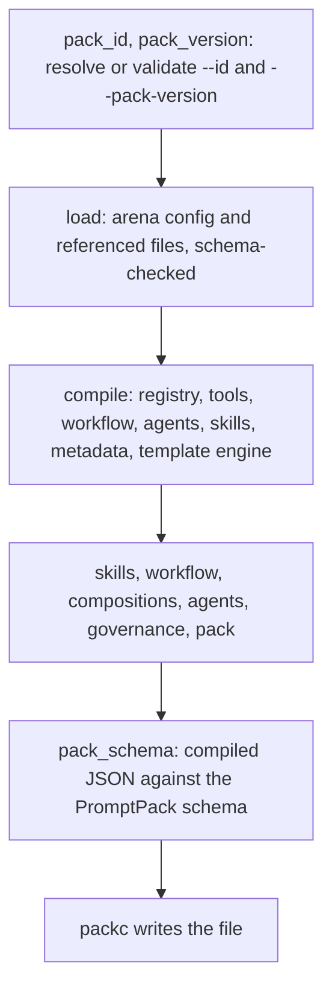

This page explains what happens between `packc compile` and the `.pack.json` file it writes: where each part of the pack comes from, what `packc` fills in, and what it checks.

## Where the compiler lives

`packc` is a thin command over the `packc/compiler` package in this repository. That package loads the arena config with PromptArena's config loader, then hands the prompts to the PromptKit runtime's pack compiler (`prompt.NewPackCompiler` and `CompileFromRegistryWithOptions`), which assembles the pack. `promptarena validate` and `promptarena export` call the same package, so a config that passes `promptarena validate` compiles with `packc compile`.

## The pipeline

`compiler.Compile` runs `compiler.Check` and keeps its output. `Check` runs these stages in order:



Each finding carries its stage name, which `packc` prints in brackets, for example `[workflow]` or `[pack_schema]`.

The stages before the checks stop the run when they fail, because nothing after them has a pack to check. Once a pack exists, `Check` runs every remaining stage and collects all of their findings before it returns. A config with three problems reports all three in one run. `packc compile` exits 1 if any finding is an error, and writes no file.

### Loading

`load` reads the arena config and every file it references. The arena config, prompt configs and tool files are each validated against their PromptArena schema as they load, and a failure stops the compile here:

```text
Compilation failed: [load] loading arena config: schema validation failed: arena configuration does not match schema:
  - spec: providers is required (value: ...)
  - spec: defaults is required (value: ...)
```

An arena config must declare `providers` and `defaults` even though the pack does not use them. A config written for `promptarena run` already has both.

### Building the pack

`compile` registers every prompt config in an in-memory prompt registry and passes the registry to the PromptKit pack compiler. That compiler adds one entry to `prompts` per prompt config, keyed by `spec.task_type`, and copies the prompt's fields across: system template, variables, allowed tools, tool policy, parameters, validators, evals, media, tested models and model overrides. Every prompt also gets the default pipeline (template, provider and validator stages).

The pack-level parts come from the arena config:

| From | To |
|---|---|
| `spec.tools` files (`kind: Tool`) | `tools`, keyed by tool name |
| `spec.workflow` | `workflow` |
| `spec.agents` | `agents` |
| `spec.compositions` | `compositions` |
| `spec.skills` | `skills`; directory paths are made relative to the config's directory, however `-c` is written; an `@org/name` installed-skill reference stays a reference |
| `spec.pack_evals` | `evals` |
| `spec.pack_metadata` | `metadata` |

The workflow, agents and compositions blocks are typed as the generated PromptPack types in the arena config, so the compiler copies them without conversion. A tool file that fails to load fails the compile, since dropping the tool would only move the error to run time.

`packc` also fills in fields that have no source in the config:

- `id` is the `--id` flag, or the current directory's name made to fit the pack ID pattern.
- `name` is the same value as `id`.
- `version` is the `--pack-version` flag, a semantic version such as `1.2.0`, or `v1.0.0` without it. It tracks the pack as a whole, while each prompt keeps its own `spec.version`.
- `description` is `Pack containing <n> prompts`.
- `$schema` is `https://promptpack.org/schema/latest/promptpack.schema.json`.
- `template_engine` is the one the prompts declare in `spec.template_engine`. A pack has one engine, so prompts that declare different ones fail the `compile` stage. The PromptKit compiler makes that choice. Prompts that declare none, or declare the default, are left out of the comparison. If no prompt declares one, the pack gets the default (`v1`, `{{variable}}`).
- `compilation` records `compiled_with` (`packc-<version>`), `created_at` (the time of the compile, RFC 3339, to the second) and `schema` (`v1`).

### Metadata from prompt configs

If the arena config has a `pack_metadata` block, it becomes the pack's `metadata`, and any prompt's `spec.metadata` is ignored with a warning. If there is no `pack_metadata`, the compiler takes `spec.metadata` from the first prompt that has one, ordered by `prompt_configs` id, and warns that it did so. It names every other prompt whose metadata it passed over. Promoting one prompt's metadata to the whole pack is a guess, so the compiler reports it instead of doing it silently.

### Media and fragments

For each prompt with `media.enabled: true`, the compiler checks that every `file_path` in its media examples exists, relative to the arena config's directory. A missing file is a warning:

```text
⚠ [compile] media(customer-support): Media file not found: images/logo.png (example: logo-example, part 0)
```

Each fragment a prompt config references in `spec.fragments` is read from its file, and its `content` is written into the pack's `fragments` map under the fragment's name. A relative `path` resolves against the directory of the prompt config that references it, not the arena config's. If no file exists there, the working directory is tried next. An inline `prompt_specs` entry has no file of its own, so its paths resolve against the arena config's directory.

- A fragment with `required: true` that cannot be read or parsed fails the `compile` stage, and the error names the file:

  ```text
  Compilation failed: [compile] compilation failed: prompt "support": required fragment "tone": reading fragment file: open /work/support/fragments/tone.yaml: no such file or directory
  ```

- An optional fragment that cannot be read is left out of the pack, with a warning:

  ```text
  ⚠ [compile] fragments: prompt "support": optional fragment "tone" was not loaded and is left out: reading fragment file: open /work/support/fragments/tone.yaml: no such file or directory
  ```

- A fragment with no `path` names no file, so it cannot be loaded: a required one fails the compile and an optional one is a warning.
- A fragment whose `name` or `path` contains `{{` is chosen by a template variable, so it cannot be resolved at compile time. It is written as the placeholder ``.

`promptarena run` loads fragments the same way, when it builds its prompt registry, so a missing required fragment stops the run before any scenario starts.

### Templates

The compiler stores `system_template` as text. It does not parse or render it, so a malformed placeholder compiles. Its only template check is that a template containing `{{` declares at least one variable. A template that references variables with none declared fails the `pack` stage:

```text
Compilation failed: [pack] prompt 'support': system_template references variables, but none are declared
```

Rendering happens in the runtime that loads the pack, with the variable values it is given.

## compile and compile-prompt

`packc compile-prompt` takes one prompt file and calls the PromptKit compiler's single-prompt path instead of loading an arena config. It checks the prompt config against its schema first, as the arena config loader does for each prompt, then runs the same structural checks and PromptPack schema check as `packc compile`. A prompt that `packc compile` would reject at `load` fails here too, and no file is written. The pack it writes differs from a `packc compile` pack:

- `id` is the task type with underscores replaced by hyphens.
- `name` and `description` come from the prompt's `metadata.name` and `spec.description`.
- `version` is the prompt's `spec.version`, or `--pack-version` when given.
- `metadata` is the prompt's `spec.metadata`.

Media references and fragment paths are resolved relative to the prompt file's directory.

## Repeatable output

The output is indented JSON with two-space indentation. Object keys come out in a fixed order, so two compiles of the same inputs with the same `packc` version produce the same bytes except for `compilation.created_at`. That field records when the compile ran. To compare two builds, strip it first:

```bash
jq 'del(.compilation.created_at)' app.pack.json | sha256sum
```

`compiled_with` records the `packc` version. A release build stamps its version at build time; a `go install …@<tag>` build reports the module version from its build information, and only a build with neither reports `packc-dev`.

## Trade-offs

Validating at compile time moves failures from deployment to the build: an unknown workflow state or a missing skill directory fails `packc compile` instead of the first conversation that reaches it. The cost is that `packc` needs the whole arena config, including the `providers` and `defaults` that only `promptarena run` uses.

Collecting every finding before failing costs a little time on a broken config. In return, a person or a coding agent fixing the config gets the full list in one pass.

Leaving templates unparsed keeps the pack independent of any template engine. The pack declares its `template_engine`, and the runtime that reads it does the rendering. The compiler therefore cannot catch a typo in a placeholder.

## Related

- [Validation](/packc/explanation/validation/): every check, and which ones block.
- [Pack format](/packc/explanation/pack-format/): the structure of the output.
- [compile reference](/packc/reference/compile/)
- [compile-prompt reference](/packc/reference/compile-prompt/)
