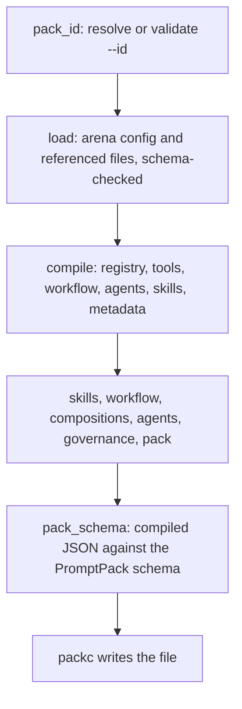

This page explains what happens between `packc compile` and the `.pack.json` file it writes: where each part of the pack comes from, what `packc` fills in, and what it checks.

## Where the compiler lives

`packc` is a thin command over the `packc/compiler` package in this repository. That package loads the arena config with PromptArena's config loader, then hands the prompts to the PromptKit runtime's pack compiler (`prompt.NewPackCompiler` and `CompileFromRegistryWithOptions`), which assembles the pack. `promptarena validate` and `promptarena export` call the same package, so a config that passes `promptarena validate` compiles with `packc compile`.

## The pipeline

`compiler.Compile` runs `compiler.Check` and keeps its output. `Check` runs these stages in order:



Each finding carries its stage name, which `packc` prints in brackets, for example `[workflow]` or `[pack_schema]`.

The first three stages stop the run when they fail, because nothing after them has a pack to check. Once a pack exists, `Check` runs every remaining stage and collects all of their findings before it returns. A config with three problems reports all three in one run. `packc compile` exits 1 if any finding is an error, and writes no file.

### Loading

`load` reads the arena config and every file it references. The arena config, prompt configs and tool files are each validated against their PromptArena schema as they load, and a failure stops the compile here:

```text
Compilation failed: [load] loading arena config: schema validation failed: arena configuration does not match schema:
  - spec: providers is required (value: ...)
  - spec: defaults is required (value: ...)
```

An arena config must declare `providers` and `defaults` even though the pack does not use them. A config written for `promptarena run` already has both.

### Building the pack

`compile` registers every prompt config in an in-memory prompt registry and passes the registry to the PromptKit pack compiler. That compiler adds one entry to `prompts` per prompt config, keyed by `spec.task_type`, and copies the prompt's fields across: system template, variables, allowed tools, tool policy, parameters, validators, evals, media, tested models and model overrides. Every prompt also gets the default pipeline (template, provider and validator stages).

The pack-level parts come from the arena config:

| From | To |
|---|---|
| `spec.tools` files (`kind: Tool`) | `tools`, keyed by tool name |
| `spec.workflow` | `workflow` |
| `spec.agents` | `agents` |
| `spec.compositions` | `compositions` |
| `spec.skills` | `skills`, with directory paths made relative to the config's directory |
| `spec.pack_evals` | `evals` |
| `spec.pack_metadata` | `metadata` |

The workflow, agents and compositions blocks are typed as the generated PromptPack types in the arena config, so the compiler copies them without conversion. A tool file that fails to load fails the compile, since dropping the tool would only move the error to run time.

`packc` also fills in fields that have no source in the config:

- `id` is the `--id` flag, or the current directory's name made to fit the pack ID pattern.
- `name` is the same value as `id`.
- `version` is `v1.0.0`. `packc compile` has no flag or config field that sets it.
- `description` is `Pack containing <n> prompts`.
- `$schema` is `https://promptpack.org/schema/latest/promptpack.schema.json`.
- `template_engine` is copied from a prompt that declares one. The prompts are visited in no fixed order, so give every prompt the same `template_engine`.
- `compilation` records `compiled_with` (`packc-<version>`), `created_at` (the time of the compile, RFC 3339, to the second) and `schema` (`v1`).

### Metadata from prompt configs

If the arena config has a `pack_metadata` block, it becomes the pack's `metadata`, and any prompt's `spec.metadata` is ignored with a warning. If there is no `pack_metadata`, the compiler takes `spec.metadata` from the first prompt that has one, ordered by `prompt_configs` id, and warns that it did so. It names every other prompt whose metadata it passed over. Promoting one prompt's metadata to the whole pack is a guess, so the compiler reports it instead of doing it silently.

### Media and fragments

For each prompt with `media.enabled: true`, the compiler checks that every `file_path` in its media examples exists, relative to the arena config's directory. A missing file is a warning:

```text
⚠ [compile] media(customer-support): Media file not found: images/logo.png (example: logo-example, part 0)
```

For each fragment a prompt config references, the pack's `fragments` map gets an entry named after the fragment whose value is the placeholder ``. The fragment's content is not copied into the pack.

### Templates

The compiler stores `system_template` as text. It does not parse or render it, so a malformed placeholder compiles. Its only template check is that a template containing `{{` declares at least one variable. A template that references variables with none declared fails the `pack` stage:

```text
Compilation failed: [pack] prompt 'support': system_template references variables, but none are declared
```

Rendering happens in the runtime that loads the pack, with the variable values it is given.

## compile and compile-prompt

`packc compile-prompt` takes one prompt file and calls the PromptKit compiler's single-prompt path directly. It skips the arena config loader and every check after it. The pack it writes differs from a `packc compile` pack:

- `id` is the task type with underscores replaced by hyphens.
- `name`, `version` and `description` come from the prompt's `metadata.name`, `spec.version` and `spec.description`.
- `metadata` is the prompt's `spec.metadata`.
- There is no `$schema`.

Beyond parsing the file, `compile-prompt` checks only media references, relative to the prompt file's directory. A prompt without `spec.version` compiles, and the pack then fails `packc validate`. Run `packc validate` on every `compile-prompt` output.

## Repeatable output

The output is indented JSON with two-space indentation. Object keys come out in a fixed order, so two compiles of the same inputs with the same `packc` version produce the same bytes except for `compilation.created_at` (and `template_engine`, if your prompts declare different ones). That field records when the compile ran. To compare two builds, strip it first:

```bash
jq 'del(.compilation.created_at)' app.pack.json | sha256sum
```

`compiled_with` records the `packc` version. A `go install` build reports `packc-dev`, because only release builds set the version string.

## Trade-offs

Validating at compile time moves failures from deployment to the build: an unknown workflow state or a missing skill directory fails `packc compile` instead of the first conversation that reaches it. The cost is that `packc` needs the whole arena config, including the `providers` and `defaults` that only `promptarena run` uses.

Collecting every finding before failing costs a little time on a broken config. In return, a person or a coding agent fixing the config gets the full list in one pass.

Leaving templates unparsed keeps the pack independent of any template engine. The pack declares its `template_engine`, and the runtime that reads it does the rendering. The compiler therefore cannot catch a typo in a placeholder.

## Related

- [Validation](/packc/explanation/validation/): every check, and which ones block.
- [Pack format](/packc/explanation/pack-format/): the structure of the output.
- [compile reference](/packc/reference/compile/)
- [compile-prompt reference](/packc/reference/compile-prompt/)
