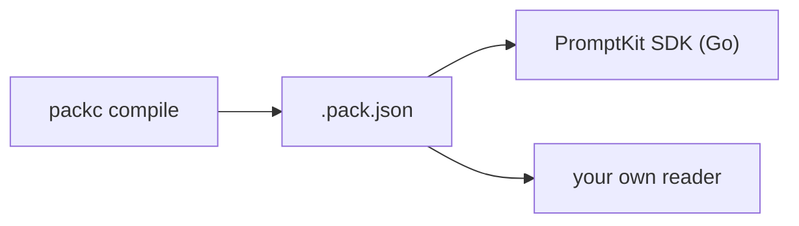
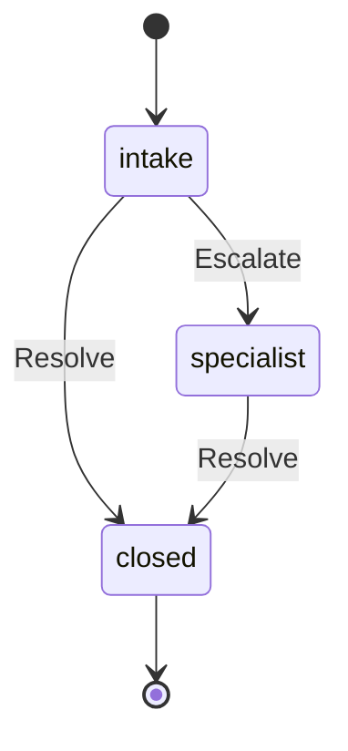

This page explains what a `.pack.json` file contains and why prompts ship as one compiled file. The [PromptPack specification](https://promptpack.org) is the authority on every field. `packc` embeds version 1.9.0 of its schema and validates against it.

## The PromptPack standard

[PromptPack](https://promptpack.org) is an open specification for packaging prompts as one JSON document. A pack holds prompts, the variables they take, the tools they may call, validators, evals, and optionally a workflow and a set of agents. Nothing in it is specific to one runtime or one provider. `packc` writes packs, and the [PromptKit SDK](https://promptkit.altairalabs.ai/sdk/) is the Go runtime that reads them. Any program that implements the schema can read one too.



## What a pack contains

A pack is one JSON object. The schema requires five top-level fields:

- `id`: the pack identifier. It starts with a lowercase letter and contains only lowercase letters, digits and hyphens (`^[a-z][a-z0-9-]*$`).
- `name`: a human-readable name.
- `version`: a semantic version, with an optional `v` prefix (`v1.0.0` or `1.0.0`).
- `template_engine`: the template engine's `version` and the variable `syntax`, such as `{{variable}}`.
- `prompts`: the prompts, keyed by task type.

Everything else is optional: `$schema`, `description`, `fragments`, `tools`, `metadata`, `compilation`, `evals`, `workflow`, `agents`, `skills`, `compositions` and `requires`. `packc` writes `compilation` itself, recording the compiler version, the time and the schema version. `packc validate` accepts a pack without `compilation` and prints a warning.

A minimal pack that passes the schema and `packc validate`:

```json
{
  "$schema": "https://promptpack.org/schema/latest/promptpack.schema.json",
  "id": "customer-support",
  "name": "Customer Support Pack",
  "version": "v1.0.0",
  "template_engine": {
    "version": "v1",
    "syntax": "{{variable}}"
  },
  "prompts": {
    "greeting": {
      "id": "greeting",
      "name": "Greeting",
      "version": "v1.0.0",
      "system_template": "You are a helpful support agent. Help the user with: {{query}}",
      "variables": [
        { "name": "query", "type": "string", "required": true }
      ]
    }
  }
}
```

### Prompts

Each entry in `prompts` requires `id`, `name`, `version` and `system_template`. The `id` matches the task type key and follows `^[a-z][a-z0-9_-]*$`, so it may contain underscores where a pack `id` may not. A prompt's `version` is independent of the pack's, so one prompt can change without the others.

A prompt can also carry `description`, `variables`, `tools` (names of pack-level tools it may call), `tool_policy`, `parameters`, `validators`, `evals`, `media`, `tested_models`, `model_overrides` and `pipeline`. `packc` fills `pipeline` with a default of template, provider and validator stages.

### Tools

`tools` is an object keyed by tool name. Each tool requires a `name` and a `description`, and usually has `parameters` (a JSON Schema for its input). `packc compile` builds it from the arena config's `kind: Tool` files. A prompt's `tools` list names entries in this object.

## Workflows

A `workflow` block is an event-driven state machine over the pack's prompts. Each state names a prompt, and named events move the conversation from one state to another.

```json
{
  "workflow": {
    "version": 1,
    "entry": "intake",
    "states": {
      "intake": {
        "prompt_task": "greeting",
        "description": "Initial customer contact",
        "on_event": { "Escalate": "specialist", "Resolve": "closed" }
      },
      "specialist": {
        "prompt_task": "specialist",
        "on_event": { "Resolve": "closed" },
        "persistence": "persistent",
        "orchestration": "external"
      },
      "closed": {
        "prompt_task": "farewell",
        "terminal": true
      }
    }
  }
}
```

The diagram shows the states and transitions in this example:



A workflow requires `version`, `entry` and `states`. `entry` names the starting state. `engine` is optional and holds runtime settings such as a `budget`.

A state usually sets `prompt_task`, which names a key in `prompts`. The schema defines these state fields:

- `on_event` maps an event name to a target state. Event names are PascalCase by convention, and `packc` warns about any that are not.
- `persistence` says whether conversation context is kept (`persistent`) or reset (`transient`) when the state is entered.
- `orchestration` says who drives transitions. `internal` (the default) means the agent does, `external` means the calling system does, and `hybrid` means both can. `composition` hands the state to the composition named in `composition`.
- `control` says who holds the next turn after entering the state: `user` or `agent`. The specification's default is `user`. The PromptKit runtime treats an absent `control` as the agent keeping the turn, so set it explicitly when it matters.
- `terminal: true` ends the workflow after the state's prompt runs. A state with no `on_event` entries is also terminal.
- `max_visits` caps how often a state can be entered, and `on_max_visits` names where to go when the cap is reached.
- `skills` scopes which skills are available in the state, as a path or `none`.
- `artifacts` declares named slots for small structured values that carry across state visits.

The PromptKit runtime accepts workflow `version` 1 or 2. Version 2 also warns about any state that has no transitions, no `max_visits` and no `terminal: true`.

## Fragments

`fragments` is an object of named text blocks that prompts share. The specification defines each value as the fragment's content, resolved at compile time. `packc` records the names of the fragments that prompts reference, with each value set to the placeholder `` rather than the fragment's text. See [Compilation](/packc/explanation/compilation/#media-and-fragments).

## Versions

A pack carries two kinds of version. `version` is the pack's own semantic version, tracking the pack as a whole, and each prompt has its own. Set the pack version with `packc compile --pack-version 1.2.0`, typically from a release tag; without the flag, `packc compile` writes `v1.0.0`. `packc compile-prompt` uses the prompt's `spec.version` unless `--pack-version` is given.

The format itself is versioned through `$schema` and `compilation.schema`. Both `packc compile` and `packc compile-prompt` write `$schema` as `https://promptpack.org/schema/latest/promptpack.schema.json` and `compilation.schema` as `v1`.

## What the format buys you

Prompts kept as loose files, or embedded in application code, work for a single prompt in one service. A compiled pack adds four properties that matter once several prompts ship together.

The pack has a published schema. Packs validate against [the PromptPack spec](https://promptpack.org) before they ship, so a malformed prompt fails the build. Anything that can read the schema can read the pack.

The pack carries versions. The pack and each prompt have a version, so a deployment can name exactly which prompts it runs, and a rollback swaps a file.

The pack is one artifact. Related prompts, their variables, their tools and their validators travel together in one file. There is no set of loose files to keep in step and no import path to resolve at runtime.

The pack is data. Reading one does not require the library that produced it, so a language this toolchain ships no client for can still use it. JSON makes that practical: every language parses it, and `jq` or a text editor can read a pack. The cost is that a pack is more verbose than the YAML it was compiled from.

## Related

- [Compilation](/packc/explanation/compilation/): how each field gets its value.
- [Validation](/packc/explanation/validation/): which rules `packc` enforces.
- [compile reference](/packc/reference/compile/)
- [validate reference](/packc/reference/validate/)
- [PromptPack specification](https://promptpack.org)
