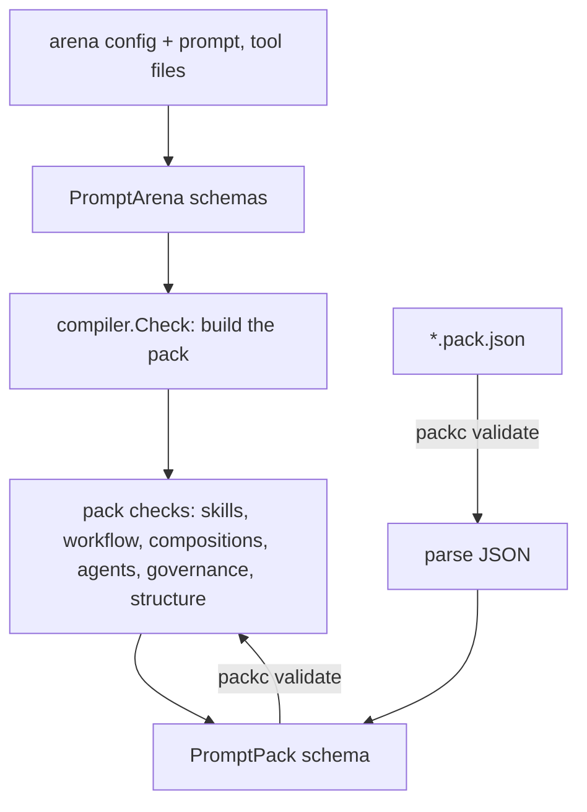

This page explains which checks run when you build or validate a pack, which of their findings stop the build, and which mistakes get through.

## Three entry points, one set of checks

Three commands validate packs, at different points:

- `packc compile` checks the source config as it builds the pack, then checks the pack before writing it.
- `packc validate` checks a pack file that already exists, wherever it came from.
- `promptarena validate` checks an arena config. For a config with `prompt_configs`, it runs the same function `packc compile` runs (`compiler.Check`) without writing a file. It also checks each assertion's type and params in an `assertions` stage that `packc` has no part in. It does not check prompt validator params; PromptKit rejects a param a validator's handler does not read when it builds the guardrail at run time.

All three run the same pack checks (`checkPack` in `packc/compiler`): the PromptKit runtime's pack checks plus this repository's skill checks. A finding is an error or a warning in all three alike, so a pack `packc compile` writes never fails `packc validate`. The differences are in what runs before the pack checks, noted in each section below.



The checks catch a mistake in the build, when the author is still at the keyboard. A runtime that loads a bad pack fails later, often on the first conversation that reaches the broken part.

## What each stage checks

### Source schemas

`packc compile` and `promptarena validate` load the arena config with PromptArena's loader, which validates the arena config, every prompt config and every tool file against its JSON schema. The patterns there mirror the PromptPack ones, so a value the pack would reject fails before anything compiles:

- `spec.task_type` starts with a lowercase letter, then lowercase letters, digits, hyphens and underscores (`^[a-z][a-z0-9_-]*$`). The task type becomes the prompt's `id` in the pack.
- `spec.version` is a semantic version, such as `v1.0.0` or `1.0.0`.
- `spec.description` is required on a prompt config.
- Each variable has a `name` matching `^[a-zA-Z_][a-zA-Z0-9_]*$` and a `required` field.
- `metadata.language` is two lowercase letters.
- Tool names match `^[a-zA-Z_][a-zA-Z0-9_]*$`.

`packc compile-prompt` checks its one prompt config against the same schema.

### Pack ID

A pack ID starts with a lowercase letter and contains only lowercase letters, digits and hyphens (`^[a-z][a-z0-9-]*$`):

```yaml
id: "customer-support"     # valid
id: "Customer Support!"    # invalid characters
id: "app-v1.2.0"           # invalid: no dots
id: "2024-demo"            # invalid: must start with a letter
```

`packc compile` rejects an invalid `--id`, or a `--pack-version` that is not a semantic version, before it loads anything. Without `--id`, it derives the ID from the current directory's name and normalizes it to this pattern: `My Project` becomes `my-project`, and a name that does not start with a letter gets a `pack-` prefix (`2024-demo` becomes `pack-2024-demo`).

### Skills

Each skill source in the pack is checked against the directory the paths are relative to: the arena config's directory for `packc compile`, and the pack file's directory for `packc validate`. These are errors:

- a skill directory that does not exist, or a path that resolves outside that directory. An `@org/name` reference is the exception: it resolves to where `promptarena skill install` put the skill, outside the pack directory, and is an error only when that skill is not installed;
- a `SKILL.md` that does not parse;
- two skills with the same name in different places;
- an inline skill without `name`, `description` or `instructions`;
- a workflow state whose `skills` path does not exist (glob patterns and `none` are skipped).

A skill whose `allowed-tools` names a tool the pack does not define is a warning.

### Workflow

The workflow check comes from the PromptKit runtime. These are errors:

- `version` other than 1 or 2, or an empty `states` map;
- an `entry` that is not a key in `states`;
- a state whose `prompt_task` is not a key in `prompts` (except composition states);
- an `on_event` or `on_max_visits` target that is not a state;
- a `persistence`, `orchestration` or `control` value outside its set;
- `composition` set without `orchestration: composition`, or the reverse.

These are warnings:

- an event name that is not PascalCase;
- a cycle in the state graph;
- a terminal state that still has `on_event` transitions;
- an `on_max_visits` target that has its own `max_visits`;
- in a version 2 workflow, a non-terminal state with no transitions and no `max_visits`;
- a cycle of `control: agent` states that never yields to the user and has no budget, terminal state or visit cap.

Real messages name the state and field:

```text
✗ Pack validation failed: app.pack.json
  - [workflow] workflow.entry "unknown" does not reference a key in states
  - [workflow] workflow.states["intake"].on_event["Escalate"] target "missing" does not exist in states
```

### Agents, compositions and governance

The agents check rejects an `agents` block with no members, an `entry` that is not a member, or a member that is not a prompt in the pack. It warns about an input or output mode that is not a MIME type, or an empty tag. The governance check rejects an obligation or review that names an eval, validator, field or obligation the pack does not declare, and warns about an undeclared vocabulary prefix. The composition check covers their step graphs, their references to prompts, tools and evals, and the workflow states that use them.

### Pack structure

The structural check covers what the schema alone does not:

- the pack has an `id`, a semantic `version` and at least one prompt;
- `template_engine` is present with `version` and `syntax`;
- each prompt has a `system_template` and a semantic `version`;
- a prompt whose template contains `{{` declares at least one variable;
- each eval, at pack level and in each prompt, has a unique `id`, a `type` and a `trigger`, a `sample_percentage` between 0 and 100, and a `metric` and `when` the runtime can use.

The structural check is PromptKit's `ValidateDetailed`, which sorts its findings into errors and warnings. `packc` treats each error as blocking:

```text
✗ Pack validation failed: app.pack.json
  - [pack] prompt 'support': missing system_template
```

Three structural findings are warnings:

- a pack with no `compilation` block. The PromptPack schema makes it optional, so a pack written by another tool can leave it out;
- a prompt whose `tools` names a tool the pack's `tools` object does not define. The specification requires prompt tools to be defined at pack level, but a host may supply tools a pack does not carry (MCP, workflow, memory and skill tools), and a prompt may list those;
- an eval `trigger` the PromptKit runtime does not know. The schema lists trigger values as examples, not a fixed set, but the runtime skips such an eval.

```text
⚠ [pack] prompt 'support': tool 'lookup_order' is not defined in the pack's tools
⚠ [pack] missing compilation metadata
⚠ [pack] pack evals[0] (id="e1"): invalid trigger "sometimes"
```

### PromptPack schema

Last, the pack JSON is validated against the PromptPack schema (version 1.9.0, embedded in the binary). The schema covers required fields, types, enums and patterns throughout the pack. Each violation is reported with its path:

```text
✗ Pack validation failed: app.pack.json
  - [pack_schema] prompts.greeting.version: Does not match pattern '^v?(0|[1-9]\d*)\.(0|[1-9]\d*)\.(0|[1-9]\d*)...' (value: )
```

`packc validate` first parses the file, so a JSON syntax error is reported as `[load] invalid JSON: …` and nothing else runs. It then runs this check before the pack checks. `packc compile` runs it last, on the JSON it is about to write.

By default the embedded schema is used, so validation works offline. The `PROMPTKIT_SCHEMA_SOURCE` environment variable changes the source: `remote` fetches the URL in the pack's `$schema`, and a path starting with `/` or `./` loads a schema file. If the schema cannot be loaded, the check reports a `[pack_schema]` error.

## Errors and warnings

An error blocks: `packc compile` writes no file and exits 1, and `packc validate` exits 1. A warning is printed with a `⚠` prefix and changes nothing. `packc compile` and `packc validate` print each warning with its stage:

```text
⚠ [workflow] workflow.states["intake"].on_event["escalate"]: event name should be PascalCase
✓ Pack compiled successfully: app.pack.json
```

When a compile fails, only its errors are printed. Fix them and compile again to see the warnings.

The split broadly follows whether the pack can run. A transition to a state that does not exist cannot be taken, so it is an error. A lowercase event name works, but breaks the specification's naming convention, so it is a warning.

## What is not checked

No command checks these, so they reach the runtime:

- Template syntax. `system_template` is stored as text, and a malformed placeholder compiles. Only the "variables declared at all" rule applies.
- Whether every placeholder in a template has a declared variable, once at least one variable is declared.
- Unreachable workflow states.
- Pack size.

Test the prompts with `promptarena run` before you compile them. A scenario that exercises each prompt catches what the static checks miss.

## Related

- [Validate packs](/packc/how-to/validate-packs/): run the checks locally and in CI.
- [Compilation](/packc/explanation/compilation/): the stages in build order.
- [validate reference](/packc/reference/validate/)
- [`promptarena validate`](/arena/reference/cli-commands/)
