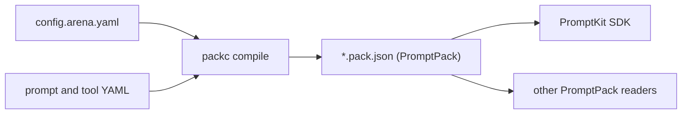

`packc` compiles a PromptArena configuration into a [PromptPack](https://promptpack.org): one JSON file holding the prompts, tools, workflow, agents and validators that the configuration references. It also validates and inspects pack files.

## What packc does

A PromptArena project keeps each prompt, tool and provider in its own YAML file, tied together by an arena config. That layout suits testing. A running application needs one artifact to load, with a schema it can check before it starts. `packc` builds that artifact.



The commands are:

- `packc compile` compiles every prompt in an arena config into one pack.
- `packc compile-prompt` compiles a single prompt file into a pack.
- `packc validate` checks a pack file against the PromptPack schema and the pack's structural rules.
- `packc inspect` prints a summary of a pack's contents.
- `packc version` prints the version, and `packc completion` prints a shell completion script.

`packc` validates against the PromptPack schema embedded in the binary, so it works offline. A pack is plain JSON, so any program that implements the PromptPack schema can read it. The [PromptKit SDK](https://promptkit.altairalabs.ai/sdk/) is the Go runtime that loads packs.

## Quick start

Install `packc` (see [Install PackC](/packc/how-to/install/) for npm, Homebrew and release archives):

```bash
go install github.com/AltairaLabs/promptarena/v2/packc@latest
```

Write a prompt file:

```yaml
# greeting.yaml
apiVersion: promptkit.altairalabs.ai/v1alpha1
kind: PromptConfig
metadata:
  name: Greeting Assistant
spec:
  task_type: greeting
  version: v1.0.0
  description: A friendly assistant that greets users
  system_template: |
    You are a friendly assistant. Greet the user warmly.
  template_engine:
    version: v1
    syntax: "{{variable}}"
```

Compile it and validate the result:

```bash
packc compile-prompt --prompt greeting.yaml --output greeting.pack.json
packc validate greeting.pack.json
```

`packc validate` prints:

```text
Validating pack: greeting.pack.json
Validating against PromptPack schema...
✓ Schema validation passed
✓ Pack structure is valid
```

For a project with an arena config, `packc compile` builds one pack from all of its prompts:

```bash
packc compile --config config.arena.yaml --output dist/my-app.pack.json --id my-app
```

Next: [Your first pack](/packc/tutorials/01-first-pack/).

## A compiled pack

`packc compile` writes indented JSON. This is the pack it produces for an arena config with one prompt:

```json
{
  "$schema": "https://promptpack.org/schema/latest/promptpack.schema.json",
  "compilation": {
    "compiled_with": "packc-2.4.0",
    "created_at": "2026-11-06T18:08:37Z",
    "schema": "v1"
  },
  "description": "Pack containing 1 prompts",
  "id": "my-app",
  "name": "my-app",
  "prompts": {
    "greeting": {
      "description": "A friendly assistant that greets users",
      "id": "greeting",
      "name": "Greeting Assistant",
      "pipeline": {
        "middleware": [
          { "config": { "allow_undefined": true, "strict_mode": false }, "type": "template" },
          { "config": { "retry_attempts": 3, "timeout": 30 }, "type": "provider" },
          { "config": { "fail_fast": false }, "type": "validator" }
        ],
        "stages": ["template", "provider", "validator"]
      },
      "system_template": "You are a friendly assistant. Greet the user warmly.\n",
      "version": "v1.0.0"
    }
  },
  "template_engine": {
    "syntax": "{{variable}}",
    "version": "v1"
  },
  "version": "v1.0.0"
}
```

[Pack format](/packc/explanation/pack-format/) describes each part.

## Documentation

### Tutorials

1. [First pack](/packc/tutorials/01-first-pack/): create and compile a pack.
2. [Multi-prompt packs](/packc/tutorials/02-multi-prompt/): bundle several prompts.
3. [Validation workflow](/packc/tutorials/03-validation-workflow/): check pack quality.
4. [Pack management](/packc/tutorials/04-pack-management/): organize and version packs.
5. [CI/CD pipeline](/packc/tutorials/05-ci-cd-pipeline/): build packs automatically.

### How-to guides

- [Install PackC](/packc/how-to/install/)
- [Compile packs](/packc/how-to/compile-packs/)
- [Validate packs](/packc/how-to/validate-packs/)
- [Organize pack files](/packc/how-to/organize-packs/)
- [CI/CD integration](/packc/how-to/ci-cd-integration/)

### Explanation

- [Pack format](/packc/explanation/pack-format/): what a pack file contains.
- [Compilation](/packc/explanation/compilation/): how `packc compile` turns a config into a pack.
- [Validation](/packc/explanation/validation/): what each command checks, and what blocks.

### Reference

- [compile](/packc/reference/compile/)
- [compile-prompt](/packc/reference/compile-prompt/)
- [validate](/packc/reference/validate/)
- [inspect](/packc/reference/inspect/)
- [version](/packc/reference/version/)

## Related

- [PromptArena](/arena/): test the prompts before you compile them.
- [PromptPack specification](https://promptpack.org)
- [Report a bug](https://github.com/AltairaLabs/promptarena/issues)
